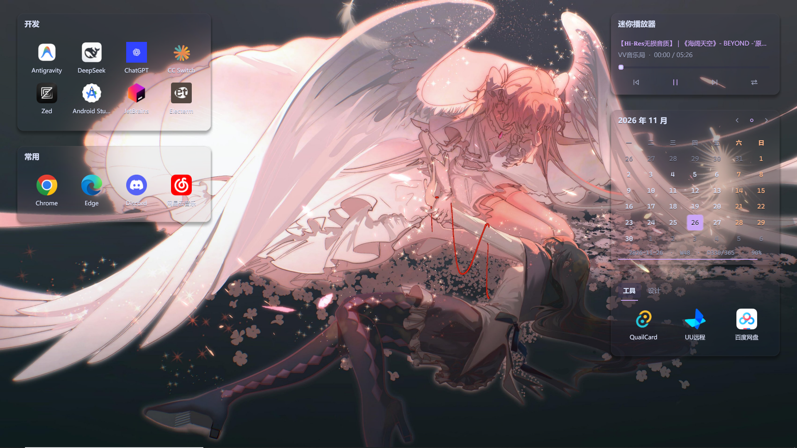
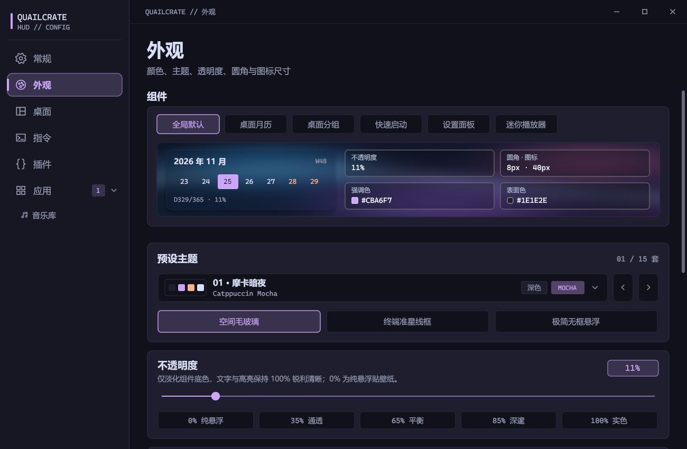
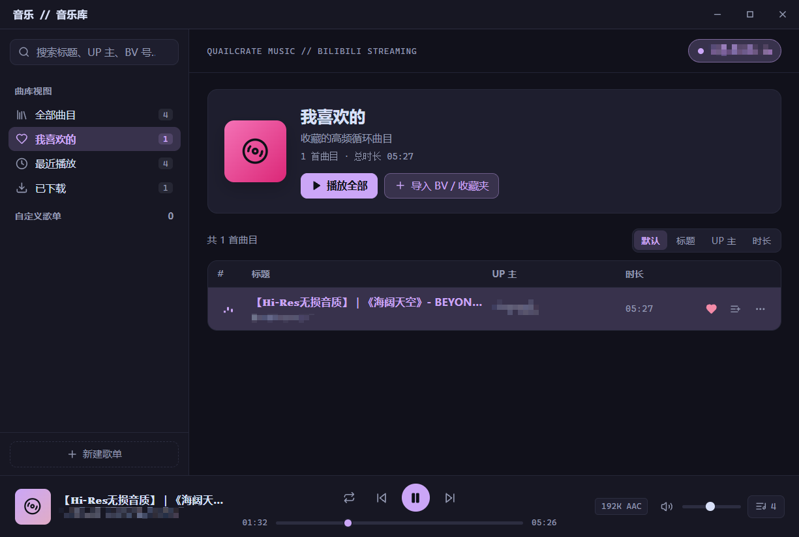
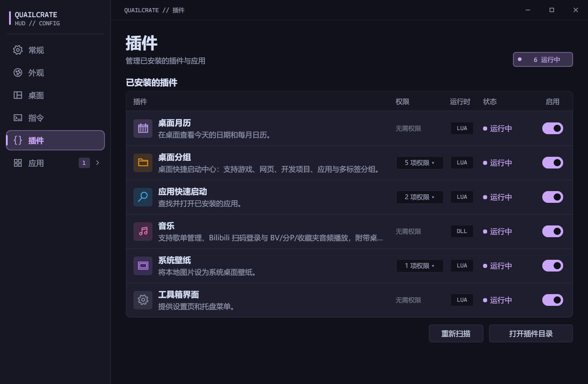

# 鹌鹑工具箱 (QuailCrate)

[English](README.md)

**鹌鹑工具箱（QuailCrate）** 是一款面向 Windows 11（64 位）的轻量桌面效率工具箱，提供应用快速启动、桌面分组、桌面月历和可扩展插件体系。配置、数据与缓存保存在程序的 `data/` 目录内。



| 外观定制与空间毛玻璃 | 可选音乐插件 | 插件与权限管理 |
| :---: | :---: | :---: |
|  |  |  |

## 核心功能

- **应用快速启动（默认 `Alt+Space`）** — 一键呼出搜索框，快速查找并启动已安装应用或桌面分组条目；支持在搜索结果上右键执行快捷操作（如直接加入桌面分组）。
- **桌面分组** — 在桌面固定分类启动面板，支持整理应用、游戏、文件夹、文件、网页链接与开发项目，提供多标签页切换与文件拖入添加引用。
- **桌面月历** — 常驻桌面的轻量月历组件，支持前后翻月、日期点选与一键返回今天。
- **音乐与迷你播放器（可选插件）** — 提供独立音乐窗口与桌面迷你播放器，支持歌单管理、Bilibili 扫码登录及 `BV` 稿件 / 分 P / 收藏夹音频播放。
- **系统壁纸与快捷指令** — 在「设置 → 指令」中一键将本地图片设为系统壁纸，或执行各插件提供的快捷命令。
- **外观定制与自由布局** — 内置多套主题预设，支持全局或按组件单独调节不透明度、圆角、图标尺寸与自定义配色；桌面组件支持拖动标题栏移动、拖动右下角缩放、双击标题栏卷起收折。
- **纯本地绿色数据目录** — 配置、组件布局、日志、插件数据与运行缓存（含 WebView2 数据）统一存放在程序目录下的 `data/` 文件夹，便于备份与迁移。

## 下载与安装

前往 [GitHub Releases](https://github.com/SuperQuail/QuailCrate/releases) 下载适用于 **64 位 Windows 11** 的最新版本：

1. **安装版（`QuailCrate-windows-amd64-setup.exe`，推荐）**
   - 当前用户级安装，无需管理员权限（默认安装至 `%USERPROFILE%\QuailCrate`），自动创建开始菜单快捷方式。
   - 覆盖升级与卸载时均会保留 `data/` 目录下的个人配置与数据。
   - 升级或卸载前，请先通过系统托盘菜单退出正在运行的 QuailCrate。
2. **便携压缩包（`QuailCrate-windows-amd64.zip`）**
   - 将压缩包完整解压到任意可写目录，直接运行 `QuailCrate.exe` 即可。
   - 请保持 `QuailCrateNative.exe` 与 `plugins/` 目录和 `QuailCrate.exe` 位于同一文件夹内。

> **提示：** 独立插件窗口（如「音乐」）依赖 Windows 11 系统自带的 Microsoft Edge WebView2 Runtime。

## 快速上手

1. **系统托盘与快捷键** — 启动后可通过系统托盘图标打开快速启动、切换桌面布局编辑、调整外观配色或进入「设置」。首次运行默认尝试注册 `Alt+Space`；若与其他软件快捷键冲突，可在 **设置 → 常规** 中修改（例如 `Ctrl+Alt+Space`）。
2. **界面语言** — 在 **设置 → 常规** 中可随时切换 **跟随系统**、**English** 或 **简体中文**。
3. **启用组件与新建分组** — 在 **设置 → 插件** 中按需启用或停用快速启动、桌面月历、桌面分组、壁纸和工作台五个内置 Lua 插件。在 **设置 → 指令** 中运行「新建桌面分组」，创建后可将文件拖入分组面板。
4. **调整桌面布局** — 在托盘菜单或 **设置 → 桌面** 中点击「编辑桌面布局」，即可自由拖动组件位置或缩放大小；调整完成后点击「完成布局编辑」保存锁定。
5. **打开独立插件应用** — 提供独立界面的插件（如「音乐」）可在 **设置 → 插件 → 应用** 或托盘菜单中直接打开。

## 安装第三方插件

1. 打开 **设置 → 插件**，点击 **从 GitHub 安装…**。
2. 输入仓库地址或 `owner/repo`、Release 页面或 ZIP 下载链接，也可使用指向 Lua 插件的 `/tree/` 链接。仓库地址优先使用最新 Release，未找到时可从默认分支安装 Lua 插件。原生 DLL 插件及含前端构建产物的插件使用 Release ZIP 安装。
3. 安装完成后，可在列表中查看插件、版本和来源仓库。首次安装时插件默认停用，打开开关即可查看授权信息并启用。

音乐播放器是独立的官方原生插件。发布 Release 后，可在 **从 GitHub 安装…** 中输入 `SuperQuail/quailcrate-music` 安装。独立插件使用自己的曲库、设置和桌面组件布局。[音乐插件仓库](https://github.com/SuperQuail/quailcrate-music)

升级或重装时，再次点击 **从 GitHub 安装…** 并输入目标版本的链接。鹌鹑工具箱根据插件 ID 匹配已安装的插件，保留其本地数据、保存状态及桌面组件布局。安装较旧版本时会要求确认。若插件新增权限，重新启用时可查看并确认。

也可以点击 **打开插件目录**，将含 `manifest.json` 的插件文件夹复制到该目录（默认为 `./data/user-plugins/`），再点击 **重新扫描**。通过任一方式安装的第三方插件均可在展开对应行后点击 **卸载**。确认后会删除插件文件、本地数据、保存状态、权限授权和桌面组件布局。

### 插件类型与安全提示

QuailCrate 支持两种插件运行方式：

- **Lua 插件** — 运行在受控沙箱环境中的轻量脚本插件，按清单声明的权限访问宿主能力。
- **原生 DLL 插件（标注「原生插件 · 完全系统权限」）** — 运行在独立 `QuailCrateNative.exe` 工作进程中的 Windows x64 原生插件，拥有当前登录用户的完整系统权限。请仅安装并启用来自可信作者的第三方原生插件；首次启用或 DLL 文件内容变更时，系统均会弹出明确的风险确认提示。

## 从源码构建与插件开发

构建宿主和原生插件运行器需要 Windows 11 x64 和 Go 1.27+。原生 DLL 集成测试还需要 Visual Studio 2022 的 C++ x64 工具链。

```powershell
# 运行开发版
go run ./cmd/quailcrate

# 运行单元测试
$env:CGO_ENABLED = '0'
go test ./...

# 构建发布压缩包 (dist/QuailCrate-windows-amd64.zip)
.\scripts\build.ps1
```

如需开发自定义插件，可参阅 [公共插件 API v2 文档](pluginapi/v2/README.CN.md)、[公共插件 API v1 文档](pluginapi/v1/README.CN.md)，以及独立示例插件 [examples/lua-widget](examples/lua-widget/) 与 [examples/notes](examples/notes/)。
