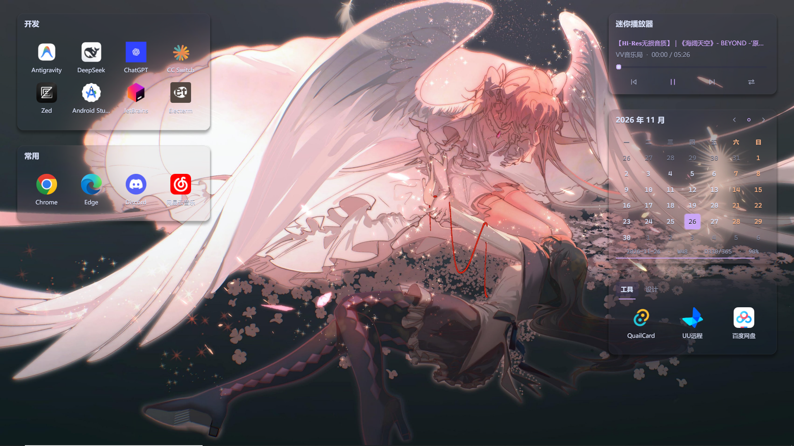
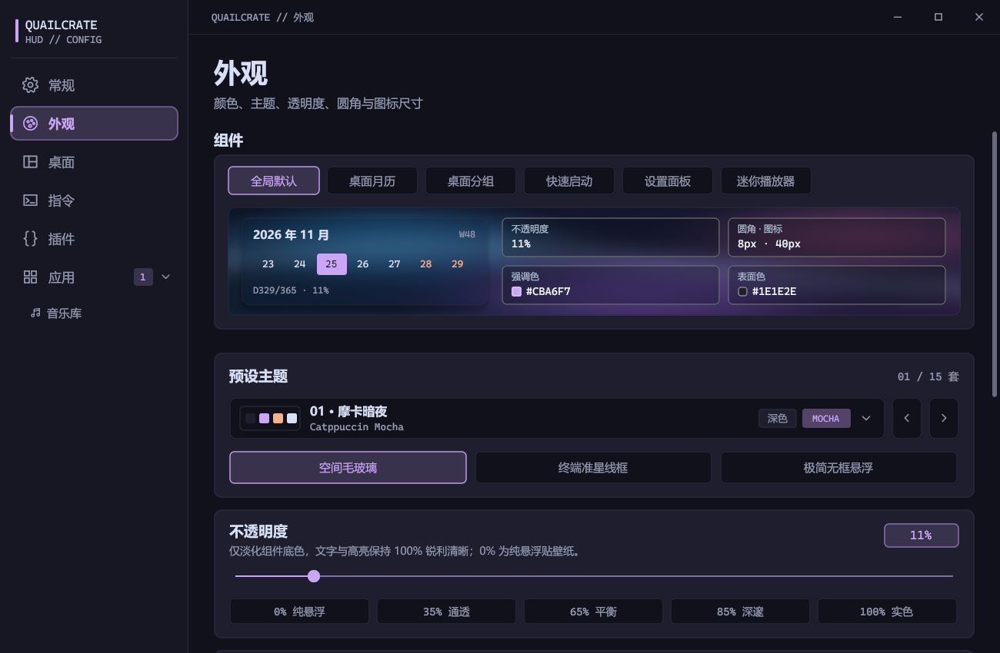
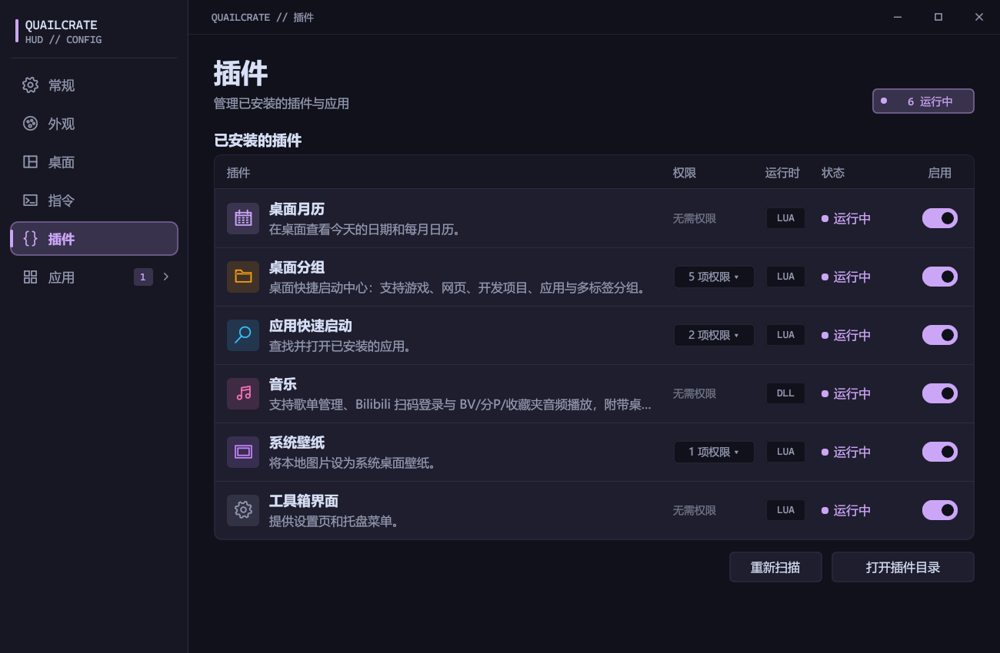

# QuailCrate

[简体中文](README.CN.md)

**QuailCrate** is a lightweight desktop toolbox for Windows 11 (x64) that brings together an application launcher, desktop groups, a desktop calendar, a music player, and extensible plugins—while keeping all settings, data, and caches cleanly inside its own folder instead of cluttering `%LOCALAPPDATA%`.



| Appearance & Spatial Glass | Music Library | Plugin Management |
| :---: | :---: | :---: |
|  |  |  |

## Highlights

- **Application Launcher (`Alt+Space`)** — Quickly search and launch installed applications or items from your desktop groups. Right-click results for quick actions such as adding an app to a group.
- **Desktop Groups** — Pin categorized launch panels to your desktop for apps, games, folders, files, web links, and project directories, with multi-tab support and drag-and-drop file references.
- **Desktop Calendar** — Keep a clean monthly calendar widget on your desktop to browse months, select dates, and jump back to today.
- **Music & Mini Player** — Manage playlists and stream Bilibili audio (QR-code sign-in, `BV` videos, multi-part pages, and favorites) from a standalone app window or a compact desktop mini player.
- **Wallpaper & Quick Commands** — Run plugin commands from Settings—such as setting a local image as your desktop wallpaper or creating new desktop groups.
- **Customizable Appearance & Layout** — Choose from built-in theme presets or customize opacity, corner radius, icon size, and colors globally or per component. Drag widget title bars to move, drag the bottom-right corner to resize, or double-click a title bar to roll up a panel.
- **Portable, Self-Contained Data** — All settings, widget layouts, logs, plugin state, and caches (including WebView2 data) live under `./data/` in the application directory for easy backup and migration.

## Installation

Download the latest release for **64-bit Windows 11** from [GitHub Releases](https://github.com/SuperQuail/QuailCrate/releases):

1. **Per-User Installer (`QuailCrate-windows-amd64-setup.exe`, Recommended)**
   - Installs without administrator privileges (defaults to `%USERPROFILE%\QuailCrate`) and adds a Start Menu shortcut.
   - Upgrades and uninstalls preserve your `./data/` folder and personal files.
   - If QuailCrate is running, exit it from the system tray menu before upgrading or uninstalling.
2. **Portable ZIP (`QuailCrate-windows-amd64.zip`)**
   - Extract the entire archive to any writable folder and run `QuailCrate.exe`.
   - Keep `QuailCrateNative.exe` and the `plugins/` folder in the same directory as `QuailCrate.exe`.

> **Note:** Standalone plugin app windows (such as **Music**) use the Microsoft Edge WebView2 Runtime, which is preinstalled on Windows 11.

## Getting Started

1. **System Tray & Launcher** — After launching `QuailCrate.exe`, click the tray icon to open the launcher, toggle layout editing, adjust themes, or open **Settings**. QuailCrate registers `Alt+Space` on first run; if Windows reports a shortcut conflict, pick another key combination (for example `Ctrl+Alt+Space`) in **Settings → General**.
2. **Language** — Switch between **System default**, **English**, and **简体中文** under **Settings → General**.
3. **Desktop Widgets & Groups** — Enable or disable built-in tools in **Settings → Plugins** (such as **Desktop Calendar**, **Desktop Groups**, and **Music**). Run **Settings → Commands → New desktop group** to create a group, then drag files onto it.
4. **Arrange Your Desktop** — Choose **Edit desktop layout** from the tray menu (or **Settings → Desktop**) to drag and resize widgets freely, then click **Finish editing** to lock positions in place.
5. **Open Plugin Apps** — Plugins with dedicated windows (such as **Music**) appear under **Settings → Plugins → Apps** and in the tray menu.

## Installing Third-Party Plugins

1. Open **Settings → Plugins** and click **Install from GitHub…**.
2. Paste a repository URL or `owner/repo`, a Release page or ZIP download link, or a `/tree/` link to a Lua plugin. Repository links use the latest release when available and can fall back to the default branch for Lua plugins. Native DLL plugins and plugins with built web assets use Release ZIPs.
3. After installation, find the plugin, version, and source repository in the list. New installations start disabled. Switch the plugin on when you are ready to review its permissions and enable it.

To upgrade or reinstall, use **Install from GitHub…** with the desired version. QuailCrate matches the package by its plugin ID and keeps plugin data, saved state, and widget layouts. Installing a lower version asks for confirmation. Review any newly requested permissions when re-enabling the plugin.

For manual installation, click **Open plugins folder**, copy the folder containing `manifest.json` into `./data/user-plugins/`, and click **Rescan**. To remove a third-party plugin from either installation method, expand its row and choose **Uninstall**. Confirming deletes the plugin files, local data, saved state, permission grants, and widget layouts.

### Plugin Types & Security

QuailCrate supports two plugin runtimes:

- **Lua Plugins** — Lightweight scripts running in a managed sandbox with scoped host permissions.
- **Native DLL Plugins (`Native DLL · Full System Access`)** — Compiled Windows x64 plugins running in an isolated `QuailCrateNative.exe` worker process with your current Windows user permissions. Only install third-party native DLL plugins from sources you trust; QuailCrate displays a clear badge and asks for confirmation before enabling a third-party DLL or whenever its file hash changes.

## Building from Source & Plugin Development

Requirements: Windows 11 x64, Go 1.27+, Node.js 24 + `pnpm` (for frontend assets), and Visual Studio 2022 Desktop development with C++ (for native DLL plugins).

```powershell
# Run in development mode
go run ./cmd/quailcrate

# Run unit tests
$env:CGO_ENABLED = '0'
go test ./...

# Build the release archive (dist/QuailCrate-windows-amd64.zip)
.\scripts\build.ps1
```

To build your own plugins, see the [Plugin API v2 documentation (Chinese)](pluginapi/v2/README.CN.md), [Plugin API v1 overview](pluginapi/v1/README.md), and the standalone examples in [examples/lua-widget](examples/lua-widget/) and [examples/notes](examples/notes/).
