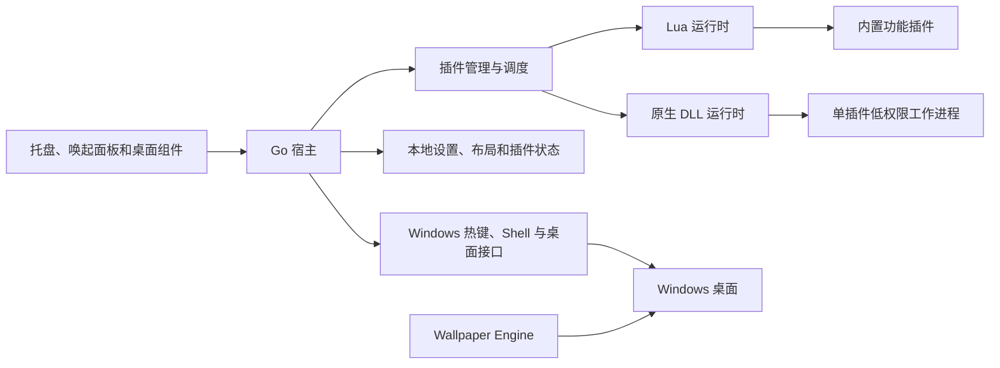

# 鹌鹑工具箱（QuailCrate）技术架构

版本 0.1 · 首版设计草案  
> **架构更新说明**：关于原生 DLL 的运行权限、伴生库加载、双向异步通知及宿主 API 边界，已由[插件双层运行时与原生全权限架构规划](plugin-runtime-tiering-plan.md)替代（原生 DLL 改为在独立工作进程中以当前用户完全权限运行，配合首次启用与哈希变更风险提示）。

业务界面通过插件交付，宿主管理公共控件、跨插件服务和第三方 DLL 工作进程。协议和迁移记录见[插件平台架构](plugin-platform-architecture.md)和[插件 UI 与通用控件库](plugin-ui-design.md)。

Go 宿主提供 Windows 集成、公共界面和插件运行环境。Lua 与 DLL 采用同一套功能契约，分别由脚本运行时和原生运行时调用。首轮验证平台为 Windows 11 x64。用户需求、首版前提和发布验收见[项目策划](project-plan.md)。

## 组件与职责



| 组件 | 职责 |
| --- | --- |
| 用户界面 | 宿主创建和管理窗口，处理焦点、输入法与拖放，渲染插件提供的搜索结果和桌面视图模型。 |
| Windows 适配层 | 注册热键、枚举和打开应用、挂载桌面窗口、处理 DPI 与显示器变化，以及调用系统壁纸接口。 |
| 插件管理与调度 | 发现插件包，验证兼容性，为已启用插件登记能力，派发事件与调用，管理停用和错误状态。 |
| 运行时适配层 | 隔离 Lua 与 DLL 的调用细节，将输入、输出和错误映射成同一个宿主契约。 |
| 功能插件 | 决定应用搜什么、分组如何编辑、月历如何呈现和壁纸命令如何配置。调用 Windows 的动作由宿主解析并执行。 |
| 本地状态层 | 保存配置、插件启用状态、布局和插件数据，执行事务和数据迁移。 |

UI 线程负责 Windows 消息循环和窗口状态。应用枚举、插件调用和持久化放在后台。窗口操作回到所属的 OS 线程执行。Windows 适配层按接口要求初始化 COM 并管理调用线程，跨线程传递应用 ID、路径等普通数据。桌面挂载原型先验证 HWND、焦点和拖放，再确定最终 UI 渲染技术。

## 插件包与发现

插件包包含 `manifest.json`、运行时入口和可选资源。以下是一个原生插件清单示例。

```json
{
  "schemaVersion": 1,
  "id": "example.native-plugin",
  "name": "原生插件示例",
  "version": "0.1.0",
  "runtime": "dll",
  "entry": "native-plugin.dll",
  "hostApiVersion": 1,
  "platform": "windows/amd64",
  "abiVersion": 1,
  "contributes": ["commands"],
  "permissions": []
}
```

- `schemaVersion` 表示清单格式，`hostApiVersion` 表示搜索、命令和组件等功能契约。`abiVersion` 是 DLL 的二进制接口版本。宿主分别核对这些版本。
- `contributes` 声明插件接入的能力，`permissions` 申请宿主提供的能力，例如 `apps.read`、`apps.launch`、`paths.open` 和 `wallpaper.set`。宿主根据插件的安装来源和功能授权决定实际可用能力。
- Lua 插件使用 `runtime: lua` 和相对于插件包目录的 `.lua` 入口。DLL 另需声明目标平台和 ABI 版本。宿主将入口解析在插件包内，并检查唯一插件 ID。来源信息由安装器或插件管理器提供。
- 首版从应用发布包提供内置插件。插件业务数据按 ID 存储，因此升级后可继续读取已有配置和布局。

## 宿主契约

插件收到包含 `requestId`、操作名和结构化内容的请求，返回请求对应的数据或错误。装载后以 `init` 注册在清单声明范围内的具体贡献。贡献 ID 与插件 ID 组成稳定标识，宿主据此分发命令和恢复组件实例。

| 操作 | 输入与输出 |
| --- | --- |
| `init` | 接收宿主 API 版本、插件自己的设置和已保存状态，返回搜索提供者、命令、组件定义及事件订阅。 |
| `search` | 接收查询文本和结果条数上限，返回结果 ID、标题、说明、匹配分与命令引用。命令引用包含命令 ID 和参数。 |
| `command` | 接收命令 ID 与经过校验的参数，返回界面更新或结构化的宿主动作。 |
| `widget_state` | 接收组件实例 ID 和视图上下文，返回列表、网格或月历等声明式数据。 |
| `event` | 接收已订阅的应用目录变更、日期更新、组件交互和宿主动作结果，返回状态更新或视图更新请求。 |
| `stop` | 在撤下贡献且当前调用结束后，释放该实例的资源。 |

宿主渲染首版组件模板，插件定义数据和交互动作。应用启动、路径打开和壁纸更改由宿主在校验权限与参数后执行。应用启动使用目录中的稳定应用 ID。宿主在插件启用和索引更新时，向已授权的订阅者发送当前可用的目录快照。插件可通过结构化请求保存自己命名空间内的数据。

### 搜索调用示例

用户输入「计算器」时，宿主生成查询请求。

```json
{
  "requestId": "q42-1",
  "op": "search",
  "payload": { "text": "计算器", "limit": 8 }
}
```

插件用相同的请求 ID 返回结果。用户选中一项后，宿主将其中的命令引用作为 `command` 输入。

```json
{
  "requestId": "q42-1",
  "ok": true,
  "data": {
    "results": [
      {
        "id": "calculator",
        "title": "计算器",
        "subtitle": "Windows 应用",
        "score": 1,
        "command": {
          "id": "open_app",
          "args": { "appId": "catalog:calculator" }
        }
      }
    ]
  }
}
```

业务失败时响应使用 `ok: false`，并提供含稳定错误码与显示信息的 `error` 对象。

### 生命周期与调度

1. **发现与校验**。读取清单和启用状态，检查入口、版本、平台和来源。校验失败时保留可诊断状态，继续处理其他插件。
2. **初始化**。运行时装载入口，恢复插件设置，调用 `init`。宿主验收返回的贡献后才开始派发请求。
3. **运行**。每个插件的调用经串行调度队列，不同插件可并发。合并尚未开始的搜索任务，接收当前查询和当前启用实例的结果，其他提供者可以先完成展示。宿主按用户操作 ID 对副作用去重，超时后由用户按需发起新操作。
4. **停用**。宿主撤下贡献、停止为该实例分配新任务、取消可取消的工作，并丢弃该实例迟到的结果和未提交的动作。进行中的调用结束后执行 `stop`。若原生调用仍被占用，界面显示停止中并允许用户重启宿主完成恢复。
5. **故障恢复**。宿主记录插件 ID、阶段及错误码。初始化失败或运行时返回错误时，其他插件可继续工作。用户可以在排除问题后重新启用；进程级故障按运行时的隔离能力处理。

### 第三方插件所需的宿主能力

[项目策划中的第三方插件方向](project-plan.md#第三方插件方向)可通过搜索、命令、组件和事件契约接入。以下是各方向涉及的宿主接口，其中额外能力按实际插件需求确认。

| 方向 | 草案已有的接入点 | 按需扩展的宿主能力 |
| --- | --- | --- |
| 扩展搜索 | `search` 返回结果，`command` 打开系统路径。 | 读取用户选定的目录或书签来源，查询 Everything 等外部文件索引。 |
| 即时工具 | 在 `search` 中运行本地换算，返回可执行的命令。 | 用户选中结果后写入剪贴板。汇率等实时换算需要网络接口。 |
| 桌面组件 | `widget_state` 渲染组件，`event` 处理交互，宿主保存插件数据。 | 订阅定时事件，读取 CPU、内存等系统指标。天气等外部数据通过网络接口读取。 |
| 快捷工作流 | `command` 可请求 `apps.launch` 或 `paths.open`。 | 为多步工作流提供宿主动作序列，以及各步骤的成功或失败结果。 |
| 桌面个性化 | `command` 触发 `wallpaper.set`，组件通过各自的视图契约挂载。 | 应用已保存的布局配置、订阅定时换壁纸事件，或经专用适配器调用 Wallpaper Engine。 |
| 服务集成 | `search` 和 `widget_state` 展示数据，`command` 处理选中后的操作。 | 访问获授权的服务、由宿主保管凭据、打开服务原页面。 |

第三方插件通过 `permissions` 申请对应宿主接口。目录读取和外部服务访问可按目录及服务范围授权。跨插件布局切换由宿主应用选定的布局配置。截图 OCR 一类原生插件可通过新增的截图输入能力或用户选图取得图像，识别结果沿用现有的结果和命令契约。

## Lua 运行时

首版采用 GopherLua（Lua 5.1）。每个插件有独立的 Lua 状态，同一状态的调用由所属调度队列持有。宿主使用 `SkipOpenLibs` 按白名单提供库和接口，将本地系统能力通过插件契约交付。若插件使用子模块，模块解析范围限定在该插件包。保护调用捕获脚本错误，`SetContext` 用于中断过期解释执行，宿主接口也遵守自己的调用期限。[GopherLua 文档](https://pkg.go.dev/github.com/yuin/gopher-lua)

内置应用启动、桌面分组、月历和系统壁纸插件以 Lua 实现功能逻辑。应用目录枚举、图标读取和壁纸设置由 Go 适配 Windows。脚本执行限制用于约束 API 访问和执行时间，进程级资源隔离需要独立运行环境。

## DLL 运行时

原生插件采用 Windows DLL 与版本化 C ABI。独立运行器先检查自己的 AppContainer 身份，再加载经过检查的 x64 DLL，解析三个固定的导出函数。[运行器入口](../cmd/quailcrate-native/main_windows.go) · [DLL 加载器](../internal/plugins/dll_windows.go)

### 加载与版本检查

- 宿主按清单解析包内入口，暂存入口与运行器，并校验发布版随附组件的摘要。工作进程按 System32 范围解析系统依赖，其他原生依赖需要静态链接。[进程与文件访问](../internal/plugins/native_process_windows.go)
- 模块加载后，宿主核对导出函数和实际 ABI 版本，再发出 `init` 请求。Windows x64 的插件导出稳定的 C 符号名，供 C、C++、Rust 等实现使用。

### ABI 草案

```c
#include <stdint.h>

uint32_t quailcrate_abi_version(void);
int32_t quailcrate_invoke(const uint8_t *request, uint32_t request_length,
                        uint8_t **response, uint32_t *response_length);
void quailcrate_free(uint8_t *response);
```

- `quailcrate_invoke` 承载 `init` 到 `stop` 的统一请求，首版控制消息采用 UTF-8 JSON。调度串行进入同一 DLL 实例。API 以一批任务为一次调用，搜索返回有上限的结果，密集计算和大块数据优先留在原生插件内部。
- 请求缓冲区由宿主持有，生命周期覆盖此次调用。插件需要在调用结束后使用输入时，复制到自己的内存。响应由插件分配，宿主校验长度上限后复制，再通过 `quailcrate_free` 释放。错误返回将输出置为空指针和零长度。
- 返回值 `0` 表示调用完成，业务结果和业务错误通过响应消息传递。非零值表示 ABI 调用失败，宿主将其映射为可诊断错误。原型需确定请求与响应的字节上限及标准错误码。

### 停用、更新与隔离

每个 DLL 实例使用独占的低权限 AppContainer 和有上限的私有管道。停用、超时或进程退出时，宿主撤下该代次的贡献、关闭 Job 并回收资源。重新启用时创建新进程。文件、网络、崩溃、卡死与同机其他插件的隔离由发布测试验证。[集成测试](../internal/plugins/dll_windows_test.go)

## Windows 集成

### 快捷启动和应用目录

- 宿主启动时读取已保存的热键设置，首次默认使用 `Alt+Space`。通过 `RegisterHotKey` 注册，收到 `WM_HOTKEY` 后打开输入面板并转交焦点。修改热键时先试注册新组合，再提交设置。保存成功后释放旧组合，保存失败时撤销本次注册。注册和保存失败在托盘设置中显示。[RegisterHotKey](https://learn.microsoft.com/en-us/windows/win32/api/winuser/nf-winuser-registerhotkey)
- 桌面应用从当前用户和公共开始菜单目录建立索引。打包应用由 Shell 应用目录枚举。用系统快捷方式或应用用户模型 ID 激活对应应用。应用目录发布不可变快照，插件收到变更后更新匹配数据。[Known Folder ID](https://learn.microsoft.com/en-us/windows/win32/shell/knownfolderid) · [应用激活接口](https://learn.microsoft.com/en-us/windows/win32/api/shobjidl_core/nf-shobjidl_core-iapplicationactivationmanager-activateapplication)
- 输入变化时生成新请求 ID，取消旧查询并把当前查询发给已启用的提供者。宿主只合并当前请求 ID 的结果，并做稳定排序。每条结果携带归属插件和命令 ID，执行前再次核对该贡献是否有效。

### 桌面组件和显示器

- `DesktopSurface` 封装组件窗口的挂载、输入和恢复。分组插件保存外部条目的引用与排序，日历插件使用宿主提供的本地日期与变更事件。布局层保存各组件实例的位置及目标显示器。
- 位置按显示器标识与逻辑像素保存。显示器或 DPI 变化时重新计算工作区，目标显示器暂时不可用时将组件放到可用的桌面区域。拖放处理与绘制使用同一套 DPI 转换。[Windows 高 DPI 桌面开发](https://learn.microsoft.com/en-us/windows/win32/hidpi/high-dpi-desktop-application-development-on-windows)
- 实际挂载策略在 M0 由桌面原型确定。原型需验证普通窗口覆盖、`Win+D` 返回桌面、拖放、Explorer 重启、Wallpaper Engine 切换以及多屏缩放。挂载目标失效时宿主重新建立桌面窗口，并从现有布局恢复组件。具体 Windows 版本和桌面环境的支持结论以实测为准。

### 壁纸

系统壁纸插件发出设置本地图片的动作，宿主用 `IDesktopWallpaper::SetWallpaper` 应用用户选择。桌面组件与壁纸由各自的窗口或系统接口管理。用户使用 Wallpaper Engine 时，由它渲染背景，鹌鹑工具箱通过桌面原型验证组件显示和交互。若确认控制需求，再增加对应插件通过其官方 CLI 操作，并报告命令结果。[Windows 壁纸接口](https://learn.microsoft.com/en-us/windows/win32/api/shobjidl_core/nf-shobjidl_core-idesktopwallpaper-setwallpaper) · [Wallpaper Engine 命令行文档](https://help.wallpaperengine.io/zh/functionality/cli.html)

## 数据与故障恢复

建议将可持久化数据放在 `%LOCALAPPDATA%\QuailCrate`，使用宿主管理的 SQLite 状态库。插件通过契约提交数据，宿主串行写入。应用索引可从 Windows 重建。日志按插件和请求关联，记录阶段、错误码和耗时。

| 数据 | 主键与内容 |
| --- | --- |
| 宿主设置 | 每用户热键与界面设置，记录生效状态。 |
| 插件状态 | 插件 ID、启用配置、当前版本和插件数据格式版本。 |
| 组件布局 | 插件 ID、组件实例 ID、显示器标识、位置和尺寸。 |
| 插件业务数据 | 插件 ID 下的版本化数据，例如分组名称、条目引用与排序。 |

一次新增或删除分组在同一事务内提交组数据与组件布局。插件数据升级以事务迁移，只有成功后才启用新格式，失败时保留上次已提交数据并显示原因。停用插件时保留配置与布局，从相同实例恢复。

## 原型与实现验证

| 验证点 | 检查方式 |
| --- | --- |
| 两种运行时的契约一致 | 用 Lua 与 DLL 示例完成发现、初始化、命令调用、停用和重新启用，比较宿主可见行为。 |
| 版本及加载失败 | 覆盖清单格式不兼容、PE 架构不匹配、导出缺失、ABI 版本不一致和依赖缺失，核对错误位置及其他插件的可用状态。 |
| 主界面响应 | 连续输入并模拟慢插件，核对当前请求结果以及关闭、拖放和重新唤起。测量策划中的两个交互延迟。 |
| 桌面与壁纸 | 在 Windows 实机执行 A03–A06，记录系统版本、Wallpaper Engine 状态、屏幕数量和 DPI。验证 Explorer 重启后的恢复。 |
| 数据恢复 | 在保存和升级失败场景下重启，确认上次提交的分组、布局与设置仍可读取。 |

两项优先验证的技术决策是桌面窗口的挂载方式，以及原生插件 ABI 与进程模型。原型结果用于固定首版实现，并回填[策划文档的适用环境和验收条件](project-plan.md#验收条件)。
