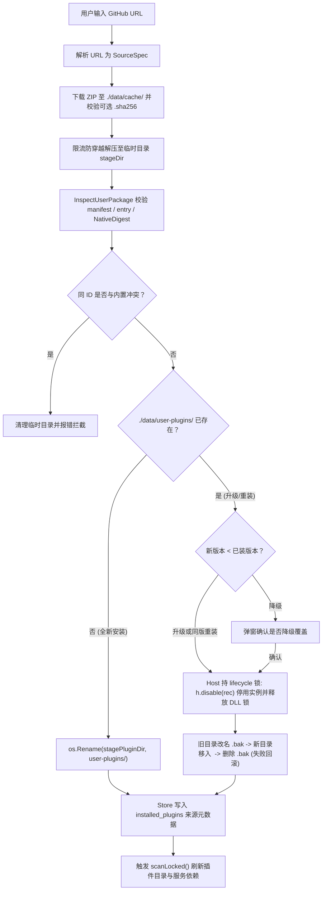

# GitHub 插件安装、升级与卸载实现计划

状态：已实现  
关联文档：[插件双层运行时规划](plugin-runtime-tiering-plan.md) · [插件平台架构](plugin-platform-architecture.md) · [公共插件 API v1](../pluginapi/v1/README.CN.md)

---

## 1. 背景与设计目标

目前 QuailCrate 的第三方插件仅支持用户手动下载、解压并放置到 `./data/user-plugins/` 目录后点击「重新扫描」加载。为了降低插件获取与更新门槛，本计划设计一套 **基于 GitHub URL 的插件安装、覆盖升级与卸载机制**。

### 1.1 核心目标
1. **极简安装体验**：用户在「设置 → 插件」中输入一个 GitHub 链接（仓库主页、Release 页、附件直链或分支子目录），宿主自动完成解析、安全下载、解压预检、落盘与列表刷新。
2. **契合双层运行时模型**：
   - **原生 DLL 插件（`runtime: "dll"`）** 与 **含前端构建产物的插件**：通过标准的 **GitHub Releases `.zip` 资产包** 分发；
   - **轻量纯 Lua 插件（`runtime: "lua"`）**：既支持 Release 资产包，也支持在无 Release 时直接拉取仓库源码分支归档，实现“零构建、推代码即能装”。
3. **安全与原子性**：严格校验重定向域名、防范 Zip Slip 与压缩炸弹；覆盖升级运行中的插件（尤其是被 `QuailCrateNative.exe` 占用的 `.dll`）时做到先停用释放句柄、失败可回滚、用户持久化数据零丢失；无缝衔接现有的权限门禁与第三方原生 DLL SHA-256 风险确认流程。

### 1.2 架构铁律遵循
- **纯 Go 实现（`CGO_ENABLED=0`）**：仅使用 Go 标准库 `net/http`、`archive/zip`、`crypto/sha256` 与现有存储/UI 组件，不引入外部 CLI（如 `git.exe`）依赖。
- **本地闭环存储**：所有临时下载缓存位于 `./data/cache/`，插件包落盘于 `./data/user-plugins/<plugin-id>/`，来源元数据存于 `./data/state.db`，绝不写入 `C:\Users\...\AppData`。
- **不污染插件目录哈希**：安装来源等宿主管理元数据仅保存在 SQLite 中，不向插件包目录内写入额外文件，确保 `ComputeNativeDigest` 二进制完整性摘要稳定纯净。

---

## 2. 插件包格式与 GitHub 发布规范

### 2.1 插件包目录结构标准
不额外发明套壳配置文件，完全复用现有 `manifest.json` 作为插件包的**唯一权威清单**：

```text
<plugin-root>/
├── manifest.json          # [必需] 唯一权威清单（id, version, runtime, entry, schemaVersion...）
├── plugin.lua / xxx.dll   # [必需] manifest.entry 指向的入口文件
├── *.dll / bin/           # [可选] 原生插件伴生动态库或辅助工具（计入 NativeDigest）
├── locales/               # [可选] en-US.json, zh-CN.json
├── web/                   # [可选] appTabs WebView 打包后的静态前端资源
└── assets/                # [可选] 图标或其他包内静态资源
```

#### 清单可选扩展字段（向后兼容，非必填）
在 `pluginapi/v1.Manifest` 中新增两个可选字段，旧插件与现有示例无需任何改动即可安装：
- `"homepage"`（`string, omitempty`）：插件文档或仓库主页 URL（仅允许 `https://`），用于在插件列表中提供快捷跳转。
- `"minHostVersion"`（`string, omitempty`）：要求宿主的最低 SemVer 版本（如 `"0.3.0"`）。若当前正式版宿主低于该版本，在安装预检阶段提前拦截并给出明确升级提示（`dev` 开发构建默认放行并记录日志）。

### 2.2 ZIP 归档层级兼容规则
无论是作者用脚本打包的 Release `.zip`，还是 GitHub 自动生成的源码归档（会自动套一层 `<repo>-<ref>/` 目录），解压器统一支持以下两种合法结构：

1. **平铺根目录**：ZIP 根路径下直接包含 `manifest.json`；
2. **单层包裹目录**：ZIP 根路径下无顶层普通文件（忽略 `.DS_Store` / `__MACOSX` 元数据噪声），且**有且仅有 1 个顶层目录**，该顶层目录直属子级包含 `manifest.json`（安装时自动剥离该外层目录）。

> 若 ZIP 内找不到 `manifest.json`，或在多个子目录中发现多个 `manifest.json`（且用户输入的 URL 未指定子目录），安装器直接拒绝并返回明确错误，不做深层递归猜测。

### 2.3 GitHub 双通道发布约定

| 发布通道 | 适用范围 | 插件作者操作 | 宿主资产选择规则 |
| --- | --- | --- | --- |
| **通道 A：GitHub Release 附件包（标准生产通道）** | **所有 `runtime: "dll"` 插件（强制）**<br>包含 `web/` 编译产物的插件<br>正式版 `lua` 插件 | 创建 GitHub Release（非 Draft），上传打包好的 `.zip` 到 Release Assets | 在目标 Release 的 `.zip` 附件中按优先级匹配：<br>1. `*.qcplugin.zip`<br>2. `*-windows-amd64.zip` / `*_windows_amd64.zip`<br>3. 若 Release **仅有 1 个 `.zip` 上传附件**，无论文件名如何直接选用；<br>4. 若存在多个普通 `.zip` 无法消歧，返回可选附件名提示用户输入具体附件下载链接。<br>*(可选增强)*：若同 Release 存在 `<asset>.sha256` 文件，下载后自动校验传输哈希。 |
| **通道 B：源码归档直装（轻量免构建回退）** | **纯 `lua` 脚本插件**（无构建步骤） | 直接将 `manifest.json` 与 `.lua` 推送到仓库分支，无需配置 CI 或发 Release | 当仓库尚无任何 Release（API 返回 `404`）或用户输入了 `/tree/<ref>[/<subdir>]` 链接时，拉取对应分支源码 ZIP。<br>**专门诊断**：若源码包中 `manifest.json` 声明 `runtime: "dll"` 但缺失编译好的 `.dll` 入口，专门提示：*“该插件为原生 DLL 插件，请从作者发布的 GitHub Release 预编译包安装”*。 |

### 2.4 支持输入的 URL 格式矩阵

| 用户输入示例 | 解析行为 | GitHub REST API 消耗 |
| --- | --- | --- |
| `https://github.com/owner/repo` 或 `owner/repo` | 查询 `repos/owner/repo/releases/latest`；若 `404`（无 Release），回退下载 `https://github.com/owner/repo/archive/HEAD.zip` | 1 次（回退不额外调 API） |
| `https://github.com/owner/repo/releases/latest` | 强制走 Latest Release（无 Release 时直接报错，不回退源码） | 1 次 |
| `https://github.com/owner/repo/releases/tag/v1.2.0` | 查询 `repos/owner/repo/releases/tags/v1.2.0` 并匹配 `.zip` 附件（若该 Release 无附件且为纯 Lua，回退 `archive/refs/tags/v1.2.0.zip`） | 1 次 |
| `https://github.com/owner/repo/releases/download/v1.2.0/foo.zip` | 直接下载该 `.zip` 资产 | **0 次**（不受 60 次/小时未认证限流影响） |
| `https://github.com/owner/repo/tree/main` | 直接下载 `archive/refs/heads/main.zip`（或对应 tag/commit 归档） | **0 次** |
| `https://github.com/owner/repo/tree/main/examples/lua-widget` | 下载 `main` 归档并仅提取子路径 `examples/lua-widget/` 作为插件根（支持 Monorepo 多插件仓库） | **0 次** |

---

## 3. 安全边界与预检流水线

### 3.1 网络与重定向防护
参考 `internal/update/release.go` 的收敛策略：
- **协议与凭据限制**：仅允许 `https` 协议、默认端口、无 URL 用户凭据（`URL.User == nil`），最多允许 5 次重定向。
- **主机名严格白名单**：初始请求与所有重定向目标仅允许：
  - `github.com`
  - `api.github.com`
  - `codeload.github.com`
  - `objects.githubusercontent.com`
  - `release-assets.githubusercontent.com`
  - `github-releases.githubusercontent.com`
- **代理与超时**：HTTP Client 默认启用 `http.ProxyFromEnvironment`（兼容用户配置的 `HTTPS_PROXY` / 系统环境代理）；元数据请求超时 `20s`（上限 `2 MiB`），归档下载超时 `3m`（单包压缩体积上限 **`128 MiB`**）。
- **限流友好提示**：当 `api.github.com` 返回 `403` / `429` 且含 `X-RateLimit-Remaining: 0` 时，返回清晰中英文提示，引导用户稍后重试或直接粘贴 Release 中的 `.zip` 下载直链（0 API 消耗）。

### 3.2 安全 ZIP 解压与资源配额
在 `./data/cache/plugin-install-<random>/` 下创建隔离工作区，解压时强制执行：
1. **路径净化**：拒绝包含驱动器盘符、以 `/` 或 `\` 开头、含 `..` 路径段、含空字节或 Windows 非法文件名的条目（严格防 Zip Slip）。
2. **文件类型白名单**：跳过目录条目，忽略 `__MACOSX/` 与 `.DS_Store`，**拒绝任何符号链接（`os.ModeSymlink`）或非常规文件**。
3. **防压缩炸弹配额**：
   - 单包普通文件总数上限：**`2000` 个**；
   - 累计实际写出字节总数上限：**`256 MiB`**（使用 `io.LimitReader` 按真实解压流计数，不盲信 ZIP 文件头声明的 `UncompressedSize64`）；
   - 大小写不敏感路径去重（Windows NTFS 大小写不敏感冲突检测，防止同名覆盖绕过校验）。

### 3.3 落盘前包完整性预检
解压并定位到候选插件根目录 `stagePluginDir` 后，在移入正式目录前执行全套静态校验：
1. 调用 `plugins.InspectUserPackage(stagePluginDir)`（复用 `discovery.go` 中的 `ValidateManifest`、`resolveFile` 入口常规文件检查、`loadTranslations` 多语言校验与 DLL `ComputeNativeDigest`）；
2. 强制非内置约束：若 `manifest.ID == "quailcrate"` 或以 `"quailcrate."` 开头，拒绝安装；
3. 强制内置防覆盖约束：若当前 `bundledDir` 已存在同 `manifest.ID` 的内置插件，拒绝安装；
4. 校验可选 `minHostVersion` 兼容性。

---

## 4. 本地落盘、覆盖升级与卸载事务

### 4.1 端到端安装与升级流程



### 4.2 关键实现细节：为什么升级时必须显式 `h.disable(rec)`
结合现有 `internal/host/host_windows.go` 中的 `scanLocked()` 逻辑，直接覆盖文件再调 `scan()` 存在两个隐患：
1. **Windows DLL 文件锁**：若旧插件是运行中的 `runtime: "dll"`，`QuailCrateNative.exe` 正以 `LoadLibraryEx` 锁定包内 `.dll`，直接覆盖或重命名文件在 Windows 下会报 `Access is denied`；
2. **运行中 Lua 实例热重载跳过**：`scanLocked()` 对 `active == true` 且权限未变的插件会执行 `else if active { continue }`，不会重新读取新 Lua 脚本。

因此，覆盖已安装同 `id` 插件时，必须在 `Host.lifecycle` 互斥锁保护下执行：
1. 若 `rec != nil && rec.generation != 0`，先调用 **`h.disable(rec)`**（等待 `QuailCrateNative.exe` 退出或 Lua 状态机关闭）；
2. 执行文件系统原子替换（旧目录 `os.Rename` 为 `.bak` -> 新目录 `os.Rename` 就位 -> 删除 `.bak`；若第二步失败则把 `.bak` 改回原名恢复）；
3. 随后调用 **`h.scanLocked()`**。此时 `rec.generation == 0`：
   - 若旧插件原本处于 `enabled = true`：
     - **Lua 插件且未新增权限**：`scanLocked()` 会自动调用 `h.enable(rec, grants)` 用新代码无缝恢复运行；
     - **Lua 插件新增了权限**：`scanLocked()` 自动将其置为 `authorization` 待授权状态，提示用户重新开启确认新权限；
     - **第三方原生 DLL 插件（二进制哈希变化）**：`scanLocked()` 检测到 `trust.SHA256 != pkg.NativeDigest`，自动挂起为 `authorization` 状态，待用户打开开关时弹出二进制变更风险确认框。
   - 若是**全新安装的插件**：`plugin_preferences` 中尚无记录，默认保持 **`disabled`（未启用）** 状态，绝不在未经用户授权前自动运行新下载的代码。
   - **用户数据全程保留**：`./data/plugins/<id>/` 私有目录、`plugin_state` 表与桌面 `widgets` 布局坐标在升级中完全不受影响。

### 4.3 第三方插件卸载流程
为闭环插件管理体验，对所有非内置插件（`!pkg.Bundled`，无论通过 GitHub 安装还是手动放入 `user-plugins`）提供**卸载（Uninstall）**功能：
1. 点击「卸载」弹出确认对话框：说明将移除插件程序文件，并提示默认清理该插件的权限与配置状态；
2. 确认后在 `Host.lifecycle` 锁下执行：
   - 若正在运行，先执行 `h.disable(rec)` 销毁桌面组件、关闭应用标签页并释放进程锁；
   - 删除 `./data/user-plugins/<id>` 目录（安全校验该路径确实位于 `h.userDir` 直接子级）；
   - 清理 SQLite 中的 `installed_plugins`、`native_plugin_trust`、`plugin_preferences`、`plugin_state` 与 `widgets` 记录，以及 `./data/plugins/<id>` 数据目录（可在确认文案中明确告知“同时清除插件本地缓存与状态数据”）；
   - 执行 `h.scanLocked()` 刷新界面与跨插件服务拓扑。

---

## 5. 数据存储与模块改动清单

### 5.1 `pluginapi/v1` 与 `internal/plugins`
- **`pluginapi/v1/types.go`**：
  `Manifest` 结构体新增可选字段：
  ```go
  Homepage       string `json:"homepage,omitempty"`
  MinHostVersion string `json:"minHostVersion,omitempty"`
  ```
- **`internal/plugins/discovery.go`**：
  - `ValidateManifest` 增加对非空 `Homepage`（要求合法 `https://` URL，长度 `<= 512`）与非空 `MinHostVersion`（符合 `versionPattern` SemVer 格式）的校验；
  - 导出预检辅助函数 `InspectUserPackage(dir string) (Package, error)`，用于在临时目录直接读取并校验单个第三方候选插件包。

### 5.2 新建 `internal/plugininstall` 包（纯逻辑层，无 UI 依赖）
建议包含以下文件：
- `source.go`：解析用户输入字符串为结构化 `SourceSpec`（区分 `KindRepoLatest`、`KindReleaseTag`、`KindDirectAsset`、`KindTreeArchive` 及可选 `Subdir`），规范化仓库 `Owner` / `Repo`。
- `github.go`：带重定向主机白名单与限流识别的 HTTP 客户端，查询 GitHub Release 元数据、按优先级挑选 `.zip` Asset、处理无 Release 时的 `HEAD.zip` 回退及可选 `.sha256` 校验。
- `archive.go`：限流防 Zip Slip 解压器、单层包裹目录自动剥离与候选根目录定位。
- `installer.go`：串联 `Stage(ctx, rawURL)`（返回包含 `Package` 清单、来源信息与清理闭包的 `StagedPlugin`）以及 `CommitSwap(targetDir, stagedDir)` 原子目录替换与备份回滚。

### 5.3 `internal/store/store.go`（数据库迁移 `user_version = 6`）
新增 `installed_plugins` 表记录插件安装来源（供界面展示来源标签及后续扩展一键检查插件更新）：

```sql
CREATE TABLE IF NOT EXISTS installed_plugins (
    id TEXT PRIMARY KEY,
    source_url TEXT NOT NULL,
    repo_owner TEXT NOT NULL DEFAULT '',
    repo_name TEXT NOT NULL DEFAULT '',
    ref_or_tag TEXT NOT NULL DEFAULT '',
    asset_name TEXT NOT NULL DEFAULT '',
    installed_version TEXT NOT NULL,
    installed_at INTEGER NOT NULL
);
```

新增 `Store` 方法：
- `InstalledPlugin(ctx, id) (InstalledPlugin, error)` / `AllInstalledPlugins(ctx) (map[string]InstalledPlugin, error)`
- `SetInstalledPlugin(ctx, meta InstalledPlugin) error`
- `PurgePlugin(ctx, id string) error`（事务内一并清理 `installed_plugins`、`native_plugin_trust`、`plugin_preferences`、`plugin_state`、`widgets`）

### 5.4 `internal/host/install_windows.go`（宿主编排层）
- 维护插件安装任务状态快照（`Installing bool`、`StatusText string`、`ErrorText string`，单次仅允许一个安装任务串行执行，防并发写冲突）；
- 实现 `PromptInstallFromGitHub()`：
  1. 调用 `h.ui.PromptText` 弹出主题自适应输入框，提示输入 GitHub 仓库或 Release 链接；
  2. 后台启动 `Stage(ctx, url)`，实时通过 `h.publish()` 向设置页推送“正在从 GitHub 下载并校验插件…”状态；
  3. 预检通过后检查是否同 ID 已安装且版本更低（若降级则调用 `h.confirm` 二次确认）；
  4. 获取 `h.lifecycle` 锁，按 4.2 节流程停用旧实例（如存在）-> `CommitSwap` 落盘到 `filepath.Join(h.userDir, id)` -> 写入 `Store.SetInstalledPlugin` -> 调用 `h.scanLocked()`；
  5. 更新安装结果横幅提示（例如：`已安装 Example Counter v1.0.0，可在列表中启用`）。
- 实现 `UninstallPlugin(id string)`：
  1. 校验目标插件存在且 `!pkg.Bundled`；
  2. 调用 `h.confirm` 弹窗确认卸载；
  3. 持 `h.lifecycle` 锁执行停用、删除插件包与私有数据目录、`Store.PurgePlugin` 及 `h.scanLocked()`。

### 5.5 `internal/gioui` 与 `internal/winui`（设置页 UI）
- **`internal/gioui/settings_model.go`**：
  - `SettingsModel` 新增 `PluginInstall SettingsPluginInstall`（包含 `Busy bool`、`Message string`、`IsError bool`）；
  - `SettingsPlugin` 新增 `Version string`、`SourceRepo string`（如 `"owner/repo"`）、`HomepageURL string`、`CanUninstall bool`；
  - `SettingsActionKind` 新增 `InstallPluginFromGitHub`、`UninstallPlugin`、`OpenPluginHomepage`。
- **`internal/gioui/settings_plugins.go`**：
  - 底部操作栏在「重新扫描」「打开插件目录」旁新增主强调按钮 **「从 GitHub 安装…」(`Install from GitHub…`)**（安装进行中置灰显示 **「正在安装…」(`Installing…`)**）；
  - 若 `PluginInstall.Message != ""`，在底部或表格上方展示简洁的状态提示条（成功或错误详情）；
  - 在插件行标题旁展示版本号（`v1.0.0`）与来源标识（如来自 GitHub 显示 `owner/repo`），在第三方插件（`CanUninstall == true`）行或展开抽屉中提供 **「卸载」(`Uninstall`)** 按钮。
- **`internal/winui/giosettings_windows.go` & `ui_windows.go`**：
  - 透传 `InstallPlugin` 与 `UninstallPlugin` 回调至 `Host`。

---

## 6. 分阶段实施与测试计划

| 阶段 | 涉及范围 | 交付内容与自动化测试验收标准 |
| --- | --- | --- |
| **阶段 1：包规范校验与 `plugininstall` 核心引擎** | `pluginapi/v1`<br>`internal/plugins`<br>`internal/plugininstall` | 1. 完成 `Homepage` / `MinHostVersion` 校验与 `InspectUserPackage`。<br>2. 实现全部 6 类 GitHub URL 解析、重定向白名单客户端、限流解压器与原子替换器。<br>3. **单元测试（`go test ./internal/plugininstall/...`）**：用本地 `httptest.Server` 模拟 GitHub API 与归档下载，覆盖：Latest Release 多 `.zip` 择优、无 Release 回退 `HEAD.zip`、`/tree/main/subdir` 子目录提取、原生 DLL 源码包无二进制友好报错、Zip Slip `../` 拦截、Symlink 拦截、超体积截断、`quailcrate.*` 命名空间拒绝、`.bak` 失败回滚。 |
| **阶段 2：数据库迁移与宿主安装/升级/卸载编排** | `internal/store`<br>`internal/host` | 1. 完成 SQLite `user_version = 6` 平滑升级与 `installed_plugins` / `PurgePlugin`。<br>2. 完成 `Host` 异步安装、运行中热覆盖升级与卸载逻辑。<br>3. **集成测试（`go test ./internal/store/... ./internal/host/...`）**：验证 v5 数据库迁移至 v6；验证全新安装默认不自动启用；验证正在运行的 Lua 插件升级后自动加载新脚本且保留 `plugin_state`；验证第三方 DLL 插件升级后二进制哈希变更自动触发重新信任门禁；验证卸载后目录与状态彻底清除。 |
| **阶段 3：设置界面接入与双语文案** | `internal/gioui`<br>`internal/winui`<br>`docs/` | 1. 接入「从 GitHub 安装…」按钮、URL 输入弹窗、进度/结果提示、版本号展示与第三方插件「卸载」按钮。<br>2. 完善 `zh-CN` / `en-US` 双语界面文案与错误提示。<br>3. 运行 `go test ./internal/gioui/... ./internal/winui/...` 及全量 `CGO_ENABLED=0 go test ./...`，并更新公开插件开发文档中的打包发布说明。 |

---

## 7. 已采用的设计决策

1. 仓库主页找不到最新 Release 时，纯 Lua 插件自动回退到默认分支源码包。DLL 插件和含 `web/` 的插件通过 Release ZIP 安装。
2. Release ZIP 优先匹配 `*.qcplugin.zip`，其次匹配 `*-windows-amd64.zip` 或 `*_windows_amd64.zip`。只有一个 ZIP 附件时可使用任意文件名。同一优先级出现多个附件时，请用户提供下载直链。
3. 确认卸载后，清除第三方插件的程序文件、私有数据、登录会话、权限授权、SQLite 状态和桌面组件布局。
4. 「从 GitHub 安装…」复用现有的主题化文本输入弹窗。
