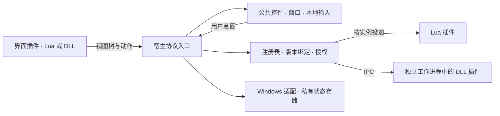

# 插件平台架构

2026-11-25。本文记录插件平台的架构、迁移目标和验收场景。开发插件时，可用的清单字段、消息和示例见 [v2 公共 API](../pluginapi/v2/README.CN.md) 和 [v2 控件库](../pluginapi/v2/UI.CN.md)。已有插件继续使用 [v1 公共 API](../pluginapi/v1/README.CN.md)。
> **架构更新说明**：文中涉及原生 DLL 低权限 AppContainer 沙箱与静态链接限制的描述已由[插件双层运行时与原生全权限架构规划](plugin-runtime-tiering-plan.md)替代。

## 架构决策

内置功能与第三方功能使用同一套公共协议。插件定义页面、布局、动作和业务状态。核心提供控件实现、窗口、输入、系统能力和插件调度。发布包默认安装快速启动、日历、桌面分组和管理界面的实现插件。用户可以更换快速启动界面，同时保留已安装的搜索提供者。管理插件可以展示权限与运行状态，实际授权记录、用户确认来源和校验由核心持有。默认界面失效时，核心保留恢复内置界面的最小入口。



### 现状与复用

| 领域 | 已有实现 | 改造方向 |
| --- | --- | --- |
| 页面 | v1 有桌面组件和应用页签，视图是扁平控件列表。v2 支持插件提交控件树和快速启动浮层 | 公共控件负责本地输入和绘制，页面布局随插件交付。[控件类型](../pluginapi/v2/ui.go) · [快速启动插件](../plugins/launcher/plugin.lua) |
| 搜索与命令 | 宿主并发查询多个搜索提供者，合并结果并记录命令归属 | 将现有搜索提供者映射为标准扩展点，为界面插件提供可安全激活的结果引用。[宿主搜索](../internal/host/host_windows.go) |
| 调度与状态 | 每个插件实例串行调度，已有实例代次、截止时间、状态事务与动作回执。应用页面还带会话和修订号 | 复用这些机制实现服务发现、跨插件回执和过期响应检查。[调度器](../internal/plugins/manager.go) · [页面会话](../internal/pluginapps/service.go) · [状态存储](../internal/store/store.go) |
| 原生插件 | 随包及第三方 Windows x64 DLL 均在各自的低权限 AppContainer 中使用 C ABI 运行。发布包内的 DLL 和运行器分别校验 SHA-256 | 安装、授权、服务和控件树与 Lua 共用同一宿主协议。[进程与权限边界](../internal/plugins/native_process_windows.go) · [工作进程入口](../cmd/quailcrate-native/main_windows.go) |

### 建议的模块归属

| 位置 | 下一阶段由该模块负责 |
| --- | --- |
| `pluginapi/v2` | 发布控件树、服务、版本匹配和 Lua 构件，以及第三方接入文档 |
| `internal/plugins` 与 `internal/host` | 前者管理实例、运行时与截止时间，后者维护贡献目录、依赖绑定、调用关联、权限判断及状态提交。UI 通过宿主路由调用插件 |
| `internal/gioui` 与 `internal/winui` | 前者实现公共控件的布局、交互与渲染，后者适配原生窗口、热键、输入法、DPI 与拖放。业务模板随所属插件发布 |
| `plugins` 与 `examples` | 内置页面使用公开 SDK。独立示例作为外部作者的参考工程，可以单独打包、安装和升级 |
| `cmd/quailcrate-native` | 通过私有 IPC 收发协议消息并加载一个 DLL。宿主控制其生命周期和操作系统授予的访问范围 |

## 三种插件协作方式

| 机制 | 契约与路由 | 示例 |
| --- | --- | --- |
| 扩展点 | 定义接受的数据、适用对象和结果格式。允许多个贡献者，按来源保留各自的动作 | `quailcrate.search.provider` 汇集应用、分组、笔记搜索。菜单扩展点 `quailcrate.result.actions` 按条目类型发现动作 |
| 服务 | 定义方法、输入输出、错误和副作用。一次调用绑定一个提供者，返回一次终态 | 服务 `quailcrate.groups.items` 的 `add` 方法接收条目引用，由分组插件选择目标、去重并保存 |
| 事件 | 已授权订阅者收到已发生的变化。通知携带来源和修订号，订阅者可据此重新查询 | 分组保存成功后发布条目变更，摘要插件刷新。高频的同一对象变更可以合并到最新修订 |

公共契约使用稳定的命名空间。平台保留 `quailcrate.*` 的**契约定义权**，第三方也能实现其中允许多实现的接口。第三方自定义接口使用其插件 ID 作为前缀。控件 ID、菜单标题和插件内部命令均各有用途。跨插件入口需要显式导出并发布自己的输入输出定义。

### 声明与发现

下列 JSON 是**目标消费者清单片段**。这个笔记插件能自主管理笔记，当存在兼容的分组服务时还提供“添加到分组”。提供者的清单则在 `provides` 中用 `id` 和精确的 `version` 声明实现。方法名、参数、返回值和授权语义随接口契约发布。

```json
{
  "schemaVersion": 2,
  "hostApiVersion": 2,
  "id": "example.notes",
  "version": "1.4.0",
  "uses": [
    {
      "id": "quailcrate.groups.items",
      "versionRange": ">=1.0.0 <2.0.0",
      "methods": ["add"],
      "optional": true
    }
  ]
}
```

宿主先读取清单，构建候选目录，检查必需依赖、接口版本和授权。必需依赖缺失或形成启动环时，插件管理页显示缺失项或完整依赖链。通过检查后才初始化实例。注册表一次性发布经过验证的实际贡献，注册范围受清单限制。可选依赖允许稍后绑定或撤下，插件据此更新相关入口。用户禁用某个插件时，宿主撤下它的提供项并使相应绑定失效。

搜索按多个来源汇集，某个慢来源可以晚些加入。会产生副作用的服务按用户选中的菜单来源、已绑定的提供者或用户设置的默认项路由。存在多个候选且没有有效绑定时，让用户选择，并记录其选择。诊断页显示调用方、接口版本、绑定的提供方和失败原因，方便查清“装了插件为什么没有这个入口”。

## 一次跨插件调用

以“搜索 OneNote → 添加到桌面分组”为例，快速启动界面和分组插件可以由不同作者开发。

1. 界面提交关键词，宿主为本次查询分配修订号，并把请求发给已启用的搜索提供者。旧查询取消。搜索结果携带展示字段，可附带可保存的条目引用。宿主为展示中的可执行命令签发短期操作引用。
2. 两种引用的寿命不同。**操作引用**绑定当前页面、查询、提供者实例和原始命令，供一次用户操作使用。**条目引用**由来源命名空间、对象类型、稳定对象 ID 组成，可以保存。对应用，由宿主解析应用目录 ID。对笔记，由笔记插件解析自己的 ID。来源被卸载时，已存条目标记“来源不可用”，以后可重新解析。
3. 分组插件向结果菜单贡献适用于该条目类型的“添加到分组”，并把菜单动作直接绑定到自己的服务方法。用户点击后，宿主验证点击对应当前视图，向该方法投递一次请求。笔记等其他插件也可通过已声明并授权的服务依赖发起同一业务请求。下面是调用方在其事件响应的 `data.actions` 中提交的动作示例。

```json
{
  "type": "service.call",
  "id": "save-selection",
  "service": "quailcrate.groups.items",
  "method": "add",
  "args": {
    "item": { "source": "quailcrate.apps", "kind": "app", "id": "catalog:onenote" }
  }
}
```

4. 分组插件在关联的界面会话里让用户选择目标。保存成功后返回 `groupId`、`itemId` 和是否新增。已存在的条目返回原 ID，取消选择返回取消状态。调用方只读取回执，分组插件对自己的数据和事务负责。下面是宿主向调用方投递的成功事件片段，同一调用只有一个终态。

```json
{
  "type": "service.result",
  "actionId": "save-selection",
  "status": "ok",
  "value": { "groupId": "work", "itemId": "item-42", "added": true }
}
```

### 调度、权限与失败

服务方法契约应随 SDK 写明可接受的条目类型、必填字段、结果及取消规则。例如 `add` 可先支持应用引用，对未知 `kind` 返回 `invalid_argument`。分组插件在支持笔记引用后才向笔记结果贡献菜单项。独立笔记示例用于验收这种扩展。

- **先提交，再分派。** 调用方返回 `service.call`，宿主验证响应，提交调用方自身的状态并释放其串行执行权，然后向目标实例派发请求。提供方也可以返回对话框动作并让出执行权。服务结果作为 `service.result` 事件排回调用方。等待用户选择的时间单独计入交互会话，各次插件执行仍有截止时间。
- **绑定来源。** 宿主为请求分配内部调用 ID，保存调用方与提供方代次、可用方法、截止时间，以及与本次操作关联的用户意图。插件提供的 `id` 用于在自身回执中关联请求。宿主校验输入与输出的类型和大小，判定调用链中的重复目标和最大深度。用户启动某个搜索结果时，授权范围限于该结果的原始动作，无法凭这个引用构造其他系统命令。
- **权限逐步校验。** 消费者需有调用指定方法的授权，提供者执行宿主动作时仍需自身对应的权限。服务声明读写性质和是否需要用户交互。各插件只读写本命名空间的状态。跨插件传递的资源引用由来源校验。
- **明确终态。** 成功、取消和失败分别返回。失败使用稳定错误码，如 `unavailable`、`incompatible_version`、`permission_denied`、`timeout` 和 `call_cycle`。关闭页面会取消关联交互。提供者停用会使挂起请求结束。调用方已重载时丢弃旧回执。写入已提交而回执丢失时，调用方按操作 ID 查询或由用户确认重试，宿主不会自动重放有副作用的请求。

## 版本与迁移

| 版本 | 决定什么 | 兼容策略 |
| --- | --- | --- |
| 插件包 `version` | 发布与插件自有数据迁移 | 保持插件和实例 ID 稳定，业务数据升级按事务提交 |
| `schemaVersion`、`hostApiVersion` | 清单格式和宿主消息 | v1 维持现有校验及行为。新清单显式选择新协议，旧宿主应报告版本不兼容 |
| `uiVersion` 与控件能力 | 可解释的节点、属性及交互 | 提交新视图树的插件声明 `uiVersion: 2`，纯服务插件可省略。启用前协商必需能力，可选节点提供降级视图。两个运行时使用同一套视图验证器 |
| 服务或扩展点版本 | 第三方之间交换的数据与语义 | 消费者声明兼容范围。兼容新增使用次版本，删除字段或改变副作用语义使用新主版本。提供者可并行导出两个主版本 |
| DLL `abiVersion` | 导出函数、调用约定、缓冲区所有权 | 只要上述二进制契约保持兼容，就可通过原有 ABI 承载新版 JSON |

v1 适配层将现有 `search` 注册映射到搜索扩展点，将现有命令的来源和参数封装成操作引用，将 `View.Controls` 翻译成新视图树。v1 的内置视觉约定在适配层还原，使旧日历、桌面分组和第三方插件能继续使用。新消费者使用显式声明的属性和动作。现有包无须通过修改清单来假装支持新方法。

## Lua 与第三方 DLL

Lua SDK 和可选的 C/C++ SDK 都负责构造相同的消息。作者也可以直接返回合法 JSON。一套契约测试对比两个运行时的视图、事件与服务回执。DLL 可以是带界面的完整插件，也可以只提供一个批量计算服务。例如 Lua 月历一次请求整月的农历数据，本地控件完成该月后续滚动、焦点变化与绘制。

C ABI v1 保留 `quailcrate_abi_version`、`quailcrate_invoke`、`quailcrate_free` 三个导出。工作进程向 DLL 借出请求缓冲区，检查 DLL 分配的响应长度、复制后交由该 DLL 释放。宿主和工作进程通过该实例独占的两条匿名管道通信。每帧以四字节小端无符号长度开头，消息上限为 4 MiB。[C 头文件](../pluginapi/v1/quailcrate_plugin.h) · [运行器协议](../internal/plugins/native_worker_windows.go)

启用 DLL 时，宿主为此次运行创建独立的低权限 AppContainer。它将工作进程与 DLL 入口复制到受保护的临时目录，仅向该实例授予读取与执行权限。发布构建校验工作进程和随包 DLL 的 SHA-256。第三方插件使用自己的 ID 命名空间，按清单申请宿主权限。工作进程只从系统目录加载 DLL 依赖，插件的其他依赖应静态链接。[隔离启动](../internal/plugins/native_process_windows.go)

Windows 在创建工作进程时应用零网络能力、Win32k 系统调用限制和 Job Object，限制单个进程、256 MiB 提交内存和整机 20% 的 CPU 时间。截止时间到期或工作进程退出时，宿主回收该实例并移除贡献。重新启用会产生新的实例代次。运行 `scripts/build.ps1 -TestNative` 可验证私有文件与本机监听端口访问被拒、共享文件只读、卡死进程回收、另一插件继续运行以及崩溃后恢复。[集成测试](../internal/plugins/dll_windows_test.go) · [Windows AppContainer 隔离](https://learn.microsoft.com/en-us/windows/win32/secauthz/appcontainer-isolation)

## 实施顺序与验收

| 阶段 | 实施内容 | 可观察的验收结果 |
| --- | --- | --- |
| 1 · 控件与页面 | 提供视图协议、v1 适配、快速启动浮层和内置界面插件。月历、分组验证组合控件 | 更换快速启动界面后仍能查询原有 v1 提供者并启动正确结果。桌面月历支持翻月、选日和返回今天。滚动、拖动、IME 与操作过程中到达的异步图标均通过窗口级回归 |
| 2 · 插件协作 | 注册表、可选依赖、按实例路由。实现结果菜单和分组 `add` 方法 | 搜索 OneNote 后可添加到用户选定的分组。卸载分组插件，菜单项消失且搜索仍可用。覆盖两个候选提供者、主版本不匹配、慢提供者、循环调用和写入后丢失回执 |
| 3 · 独立作者验证 | 随公共文档发布独立笔记示例，笔记结果带稳定引用 | 作者仅用公开 SDK 注册搜索，展示笔记并添加到分组。已有笔记引用在提供者停用后保留，重新启用后可恢复打开 |
| 4 · 原生生态 | 用受信 DLL 实现桌面月历并导出月份数据服务，验证独立工作进程 | Lua 和 DLL 月历可分别启用，桌面交互返回等价视图，各自的月份服务可供其他插件调用。杀掉或卡住一个 DLL，其余插件可交互。超权限资源操作被操作系统或宿主代理拒绝。重启后过期回执无法更新新页面 |

各阶段先验证可独立运行的最小场景，再迁移其他内置页面。长期需要保留的是公开契约、数据所有权和这些行为测试，运行器与 UI 后端可以独立演进。
