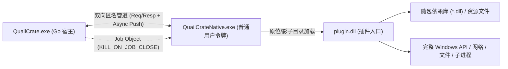

# 插件双层运行时与原生全权限架构规划

状态：规划定稿（替代旧版原生插件 AppContainer 强沙箱假设）  
关联文档：[插件平台架构](plugin-platform-architecture.md) · [技术架构](architecture.md) · [公共插件 API v2](../pluginapi/v2/README.CN.md)

## 1. 背景与核心问题

在早期架构中，QuailCrate 同时对 Lua 与原生 DLL 插件施加了强沙箱限制：DLL 工作进程被放入零权限 Windows AppContainer，禁用 Win32k GUI 系统调用，限制单进程、256 MiB 内存、20% CPU，且仅将单个入口 DLL 拷贝到临时目录按 `LOAD_LIBRARY_SEARCH_SYSTEM32` 加载。

这一设计在实际插件开发中暴露了根本性矛盾：

1. **宿主 API 陷入“永远补不完”的死循环**：每开发一个稍复杂的插件（如音乐流媒体、系统工具、深度搜索），宿主都必须在 Go 侧新增专门的网络会话、流媒体解码、文件配额或系统调用代理（如 `internal/pluginaudio`、`internal/pluginio`、`internal/pluginfiles`），维护成本极高且无法覆盖长尾需求。
2. **原生 DLL 退化为“更难写的 Lua”**：插件作者即便付出 C/C++/Rust 编译与内存管理成本，依然无法调用常规 Win32 API、无法联网、无法携带第三方动态库（如 `sqlite3.dll`、`ffmpeg`、`bass.dll`）、无法拉起外部命令行工具，失去了原生插件存在的意义。
3. **产品场景错位**：桌面效率工具箱不同于加载未知网页脚本的浏览器。第三方插件由用户主动下载放入插件目录并手动启用，核心价值恰恰在于深度操作系统集成。

---

## 2. 核心架构原则

### 2.1 双层运行时定位：简单归 Lua，复杂归全权限 DLL

| 维度 | Lua 插件（`runtime: "lua"`） | 原生 DLL 插件（`runtime: "dll"`） |
| --- | --- | --- |
| **目标场景** | 轻量小组件、快捷指令、文本/计算搜索、简单 HTTP 接口展示、视图编排 | 系统深度集成、原生硬件/键鼠/剪贴板交互、复杂音视频引擎、本地数据库、第三方 SDK、子进程调用 |
| **开发体验** | 单脚本免编译、开箱即用、热重载极快 | C / C++ / Rust / Go (c-shared) / Zig 等任意可导出 C ABI 的原生语言，自由链接外部库 |
| **系统权限** | **受控沙箱**：`gopher-lua` 白名单标准库，仅能通过清单 `permissions` 调用宿主既有工具 API | **完全用户权限（Full User Token）**：与当前登录桌面用户同权，可直接访问网络、文件系统、注册表、Win32/COM API 及创建子进程 |
| **崩溃与资源隔离** | 宿主进程内独立 `lua.LState`，保护调用 + `Context` 超时中断 | **独立工作进程（`QuailCrateNative.exe`）**：去权限沙箱但保留进程隔离，原生崩溃不波及主程序 |
| **安全与信任机制** | 按清单细粒度权限授权（延续现有机制） | **显著标识 + 用户风险确认**：标记「原生插件 · 完全系统权限」，首次启用及二进制变更时弹窗警告，用户自担风险 |

### 2.2 宿主 API 边界铁律：只做“壳”，不再做“系统库”

自本规划生效起，宿主协议严格收敛于 **QuailCrate 壳层交互与跨插件协作**，停止扩充操作系统与媒体/IO 代理能力：

- **宿主继续维护与演进的能力（Shell & UI Surface）**：
  - 快速启动搜索提供者（`quailcrate.search.provider`）与结果上下文菜单（`quailcrate.result.actions`）；
  - 桌面组件容器与声明式 v2 控件树渲染（`pluginapi/v2`）；
  - 系统托盘菜单项（`tray`）与命令入口（`commands`）；
  - 应用独立窗口与包内 WebView 页面桥接（`appTabs` / `PAGES`）；
  - 跨插件服务调用与事件发布订阅（`provides` / `uses` / `publishes` / `listens`）；
  - 轻量状态持久化（`data.state`）。
- **宿主冻结不再新增的能力（OS / IO / Media Proxies）**：
  - **不再新增** 专用网络协议代理（如 WebSocket、原始 TCP/UDP、自定义代理池）；
  - **不再新增** 宿主内置音视频解码/混音/转码格式支持；
  - **不再新增** 宿主代理的剪贴板监听、全局钩子、窗口自动化、硬件传感器、注册表、外部进程执行等系统接口；
  - 已有的 v1/v2 工具动作（`http.request`、`files.*`、`timer.*`、`audio.*` 等）作为 **Lua 标准底座保留维护**，超出其边界的需求一律采用原生 DLL 插件实现（或由一个原生 DLL 插件封装能力后通过 `provides` 服务接口供多个 Lua 插件调用）。

---

## 3. 原生 DLL 运行时改造设计



### 3.1 移除沙箱限制，保留独立工作进程

改造 `internal/plugins/native_process_windows.go` 与 `internal/plugins/native_worker_windows.go`：

1. **取消 AppContainer 与令牌校验**：
   - 移除 `CreateAppContainerProfile`、`DeleteAppContainerProfile`、`PROC_THREAD_ATTRIBUTE_SECURITY_CAPABILITIES` 与 `allApplicationPackagesPolicy`；
   - 移除 `RunNativeWorker()` 中对 `TokenIsAppContainer` 的强制检查；
   - 工作进程直接继承当前用户的常规桌面进程令牌（不提权为管理员，保持与 `QuailCrate.exe` 相同的用户级权限）。
2. **取消系统调用与资源硬限**：
   - 移除 `PROC_THREAD_ATTRIBUTE_MITIGATION_POLICY` 中的 `disableWin32k` 限制，允许原生插件调用 `user32.dll`、`gdi32.dll`、剪贴板、窗口枚举、系统托盘/消息钩子及 COM/Shell 接口；
   - 移除 Job Object 上的 `JOB_OBJECT_LIMIT_ACTIVE_PROCESS (1)`、`JOB_OBJECT_LIMIT_PROCESS_MEMORY (256 MiB)` 与 20% CPU 速率硬限，允许插件拉起外部 CLI 子进程（如 `ffmpeg`、`git`、辅助守护程序）及执行重计算。
3. **保留生命周期兜底回收**：
   - **继续保留独立工作进程 `QuailCrateNative.exe`**，隔离空指针/野指针崩溃、内存泄漏与阻塞线程；
   - **继续保留 Job Object 的 `JOB_OBJECT_LIMIT_KILL_ON_JOB_CLOSE`**：当插件停用、重载或 `QuailCrate.exe` 异常退出时，操作系统自动清理该工作进程及其派生的子进程树，杜绝残留僵尸进程；
   - 正常传入系统环境变量（如 `PATH`、`SystemRoot`、`TEMP`、`APPDATA`、`LOCALAPPDATA`、`USERPROFILE`），同时通过显式上下文或环境变量提供 `QUAILCRATE_PLUGIN_DIR`（插件包目录）与 `QUAILCRATE_PLUGIN_DATA_DIR`（当前工作目录下 `data/plugins/<id>` 专属持久化目录）。

### 3.2 插件目录与伴生依赖加载

改造 `internal/plugins/dll_windows.go` 与暂存策略：

1. **伴生 DLL 与包内资源可见性**：
   - 废除“只复制单个 `plugin.dll` 到临时目录且仅用 `LOAD_LIBRARY_SEARCH_SYSTEM32` 加载”的策略；
   - 工作进程将当前工作目录设为插件包目录 `pkg.Dir`；
   - 使用 `windows.LoadLibraryEx(entryPath, 0, windows.LOAD_LIBRARY_SEARCH_DLL_LOAD_DIR | windows.LOAD_LIBRARY_SEARCH_DEFAULT_DIRS)` 加载入口 DLL，使插件包同目录及子目录下的伴生动态库（如 `sqlite3.dll`、`onnxruntime.dll`）与包内静态资源可直接解析读取。
   - *可选增强（热更新友好）*：开发模式或需要覆盖文件升级时，只要先 `Disable` 插件，工作进程即退出并释放所有文件句柄，用户可直接覆盖更新整个插件目录后再 `Enable`。

---

## 4. 双向异步通信协议（C ABI v2 扩展）

全权限 DLL 往往在内部维护后台线程（例如：WebSocket 长连接、全局快捷键监听、剪贴板监听、独立音频播放进度回调、文件夹监控）。如果仅靠宿主单向同步调用 `quailcrate_invoke`（限时 2 秒），DLL 仍无法主动唤醒宿主更新界面。

### 4.1 管道多路帧协议

在不破坏单线程串行请求语义的前提下，将宿主与 `QuailCrateNative.exe` 之间的管道帧扩展为带帧类型的双向流（通过帧首字节或 JSON 顶层信封区分）：

- **Host -> Worker**：`Request`（`init` / `search` / `command` / `widget_state` / `tab_state` / `service` / `event` / `stop`）
- **Worker -> Host**：
  1. `Response`：对应当前正在执行的 `requestId` 的同步返回；
  2. **`Notify`（新增异步上行帧）**：原生插件可在任意时刻（含后台线程，由运行器内部加互斥锁写管道）向宿主推送主动通知。

### 4.2 C ABI 导出兼容与扩展

完全保留 `abiVersion: 1` 的三个导出函数，确保现有 DLL 零修改运行；新增 `abiVersion: 2`（或在 ABI v1 基础上检测可选导出符号 `quailcrate_bind_host`）：

```c
// 宿主在调用 init 前注入的主动通知回调，线程安全，插件可在任意后台线程调用。
// 返回 0 表示已投递至工作进程管道，非 0 表示载荷超限或实例正在关闭。
typedef int32_t (*quailcrate_host_notify_fn)(
    const uint8_t *notification_json,
    uint32_t notification_length);

// 可选导出（ABI v2 推荐）：模块加载后、首次 invoke("init") 前调用一次
QUAILCRATE_PLUGIN_EXPORT void quailcrate_bind_host(quailcrate_host_notify_fn notify);
```

插件通过 `notify` 上报的 JSON 复用宿主既有的安全动作/事件语义（绑定当前实例 `generation`，过期自动丢弃）：

- 请求刷新桌面组件：`{"type": "widget.refresh", "widgetId": "monitor"}`
- 通知应用页拉取最新状态或推送增量事件：`{"type": "page.notify", "tabId": "main", "detail": {...}}`
- 发布跨插件主题事件：`{"type": "event.publish", "topic": "clipboard.changed", "args": {...}}`
- 异步触发已声明的宿主壳层动作（如更新状态或请求通知）。

> **超时策略区分**：UI 路径上的同步查询（`search`、`widget_state`、`tab_state`）继续保持短截止时间（如 2 秒）以防阻塞界面响应，而耗时 IO/后台任务一律由 DLL 放入自身后台线程执行，完成后通过 `notify` 异步回推宿主。

---

## 5. 信任分级与用户风险提示（Warning & Consent）

开放 DLL 完全权限后，安全性责任边界从“操作系统强沙箱拦截”转向“明确风险告知 + 用户自主授权”：

1. **随包内置插件（`pkg.Bundled == true`，命名空间 `quailcrate.*`）**：
   - 发布构建继续校验内置 DLL 与 `QuailCrateNative.exe` 的 SHA-256，无需弹出第三方高危警告。
2. **第三方原生插件（用户目录 `runtime: "dll"`）**：
   - **插件列表标识**：在「设置 → 插件」列表中显著展示风险标签：**`原生插件 · 完全系统权限`**（英文：`Native DLL · Full System Access`）。
   - **首次启用确认弹窗**：用户点击启用第三方 DLL 插件时，必须弹出二次确认对话框，明确告知：
     > 该插件为原生二进制组件（DLL），将以当前系统用户的完全权限运行，可自由读写本地文件、访问网络及调用系统接口。请仅启用来自可信作者的插件，因第三方原生插件导致的数据损坏或系统异常由插件作者及用户自行承担。
   - **二进制变更重确认**：宿主在本地 `store` 中记录已确认信任的 `(pluginId, entryDLLSha256)`（或包内所有 `.dll`/`.exe` 清单摘要）。当用户更新或替换了插件目录下的二进制文件导致哈希变化时，下次启用或启动自动加载前会挂起并要求用户重新确认一次，防止静默篡改。
   - **宿主协议权限简化**：第三方全权限 DLL 已拥有完整系统能力，若其同时使用宿主的壳层能力（如读取宿主维护的应用目录 `apps.read`、启动宿主目录应用 `apps.launch`），可在同一次确认弹窗中合并授权，无需拆分成繁琐的多次弹窗。

---

## 6. 实施路线图

| 阶段 | 模块范围 | 交付内容与验收标准 |
| --- | --- | --- |
| **阶段 1：解除原生沙箱与开放依赖加载** | `internal/plugins/native_process_windows.go`<br>`internal/plugins/native_worker_windows.go`<br>`internal/plugins/dll_windows.go`<br>`internal/plugins/dll_windows_test.go` | 1. 移除 AppContainer、Win32k 禁用、单进程限制及 256MB/20% CPU 限制，保留独立 `QuailCrateNative.exe` 与 `KILL_ON_JOB_CLOSE`。<br>2. 改为在插件包目录原位解析 `LOAD_LIBRARY_SEARCH_DLL_LOAD_DIR \| LOAD_LIBRARY_SEARCH_DEFAULT_DIRS`，注入 `QUAILCRATE_PLUGIN_DIR` 与 `QUAILCRATE_PLUGIN_DATA_DIR`。<br>3. 更新原生集成测试：验证 DLL 可正常读写文件、访问本地回环网络、调用 User32 API、加载同目录伴生 DLL，且 DLL 崩溃或死锁时主程序不受影响、停用后文件锁正常释放。 |
| **阶段 2：第三方 DLL 风险警告与信任记录** | `internal/store`<br>`internal/host`<br>`internal/gioui/settings_plugins.go`<br>`internal/winui` | 1. 状态库新增第三方原生插件的哈希信任记录 `(plugin_id, sha256, trusted_at)`。<br>2. 插件管理页展示「原生插件 · 完全系统权限」标签。<br>3. 实现首次启用与 DLL 哈希变更时的中英双语风险确认对话框；未确认前不拉起 `QuailCrateNative.exe`。 |
| **阶段 3：双向管道与 C ABI 主动通知** | `pluginapi/v1/quailcrate_plugin.h`（或 `v2`）<br>`internal/plugins/native_worker_windows.go`<br>`internal/plugins/manager.go`<br>`internal/host` | 1. 升级管道读写循环支持 `Worker -> Host` 异步通知帧，保持 ABI v1 兼容并支持 `quailcrate_bind_host`。<br>2. 宿主按实例 `generation` 校验并路由 `widget.refresh`、`page.notify`、`event.publish`。<br>3. 编写包含后台线程主动推送的原生示例测试，验证无需 `timer.after` 轮询即可实时刷新桌面组件与 WebView 应用页。 |
| **阶段 4：文档同步与生态样例整理** | `README.md` / `README.CN.md`<br>`pluginapi/v1` & `pluginapi/v2`<br>`docs/` · `examples/` | 1. 更新所有公开 README 与 SDK 文档中关于 AppContainer 沙箱和静态链接限制的旧描述。<br>2. 提供一个清晰的原生插件模板示例（展示伴生库加载、本地/系统 API 调用及后台事件推送），以及“原生服务插件 (`provides`) + Lua 界面插件 (`uses`)”协作范例。 |
