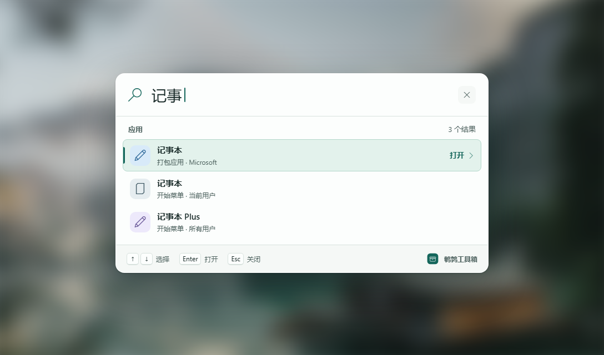
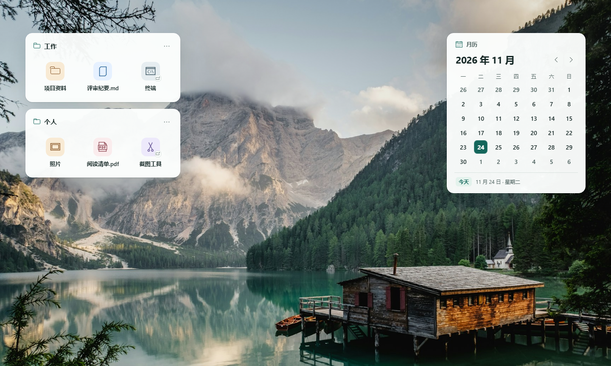
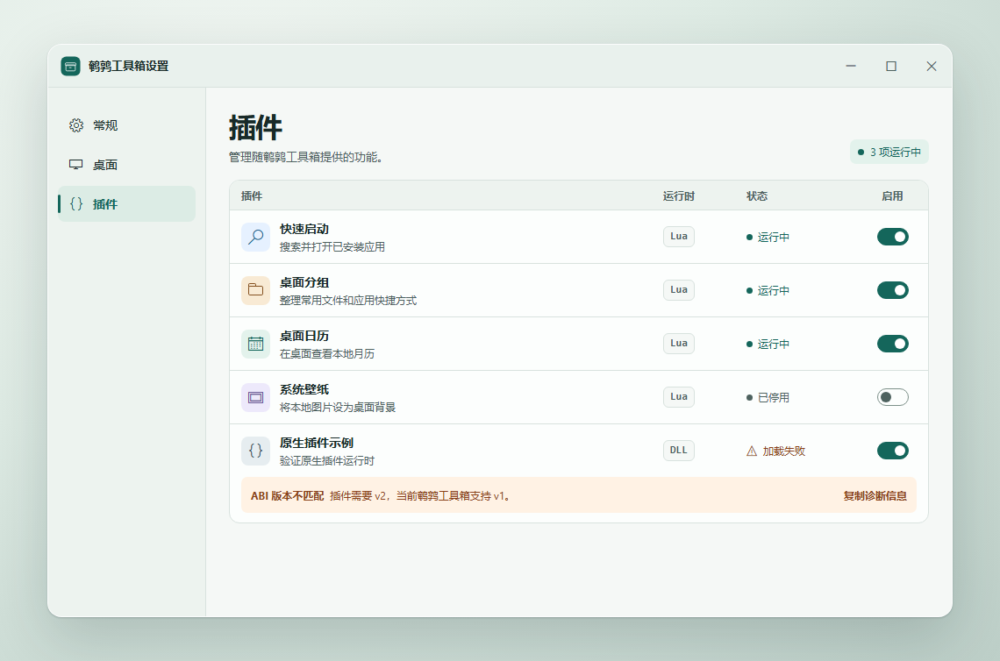
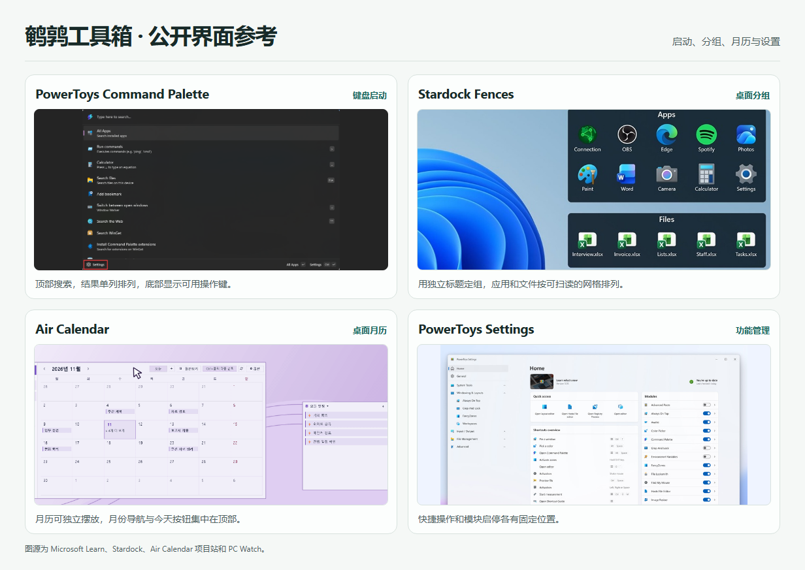

# 鹌鹑工具箱首版 UI 设计

本页保留首版的界面场景与视觉参考。下一阶段由插件声明这些页面，核心提供公共控件和窗口适配。[插件 UI 与通用控件库设计](plugin-ui-design.md) · [插件平台架构](plugin-platform-architecture.md)

鹌鹑工具箱按操作出现的时机安排界面。键盘唤起后直达应用搜索，回到桌面就能用分组和月历，需要改快捷键、壁纸或插件时才打开托盘设置。首版沿用 Windows 11 x64 的验收范围。[项目策划](project-plan.md) · [技术架构](architecture.md)

## 三张界面参考图

### 快速启动

默认尝试注册 `Alt+Space`。成功唤起后输入框立即获得焦点，窗口位于前台应用所在屏幕的中上部。结果一行一个应用，图标和名称优先，同名应用显示打包应用或开始菜单来源。上下键选择，Enter 打开，Esc 关闭。组字期间由中文输入法处理确认与取消，关闭浮窗后焦点回到原窗口。图中的虚化背景用于呈现浮窗，实机唤起时继续显示当下的应用窗口或桌面。

空查询只显示输入框与提示。已有查询时根据结果增高窗口，建议首屏最多 5 行，超出可滚动。有查询的空结果提示「没有找到应用」，首次索引未完成时提示「正在准备应用列表」。快捷键冲突由托盘和「常规」页提示，托盘菜单提供「打开快速启动」作为入口。

### 桌面分组与月历

分组默认沿左侧叠放，月历默认靠右，并可独立移动。分组项用系统图标和短名称，点击交给 Windows 打开。托盘「编辑桌面布局」负责新建、移动和调整分组。拖入时高亮有效目标并显示落位，移除用「从分组移除」，保留源文件。分组菜单提供「添加项目」「重命名」及条目顺序调整的键盘入口。目标失效时在对应条目上显示「找不到文件」并允许移除引用。

月历在年月右侧提供上月和下月按钮，点击底部「今天」回到本月。图中以 2026 年 11 月 24 日为样例。组件底色保持接近实色，边缘用轻描边，便于在深浅不同的壁纸上阅读。显示器拔除时把组件移入现有显示器工作区，避免落在任务栏或可视范围之外。

### 托盘设置与插件

左侧入口为「常规」「桌面」「插件」。常规负责快捷键录入、注册状态和外观。桌面负责布局编辑、本地 JPG 或 PNG 选图以及设置结果，Wallpaper Engine 场景按共存验收。插件页按行展示名称、用途、Lua 或 DLL、实际运行状态和启用开关。开关表达用户配置，状态列报告实际运行结果，启用的插件也可能加载失败。

运行状态建议包含「加载中」「运行中」「已停用」「停止中」「加载失败」。停用后撤下插件贡献并保存布局。图中模拟 DLL ABI 不兼容，故障行直接展示原因和「复制诊断信息」。诊断信息建议包含插件 ID、失败阶段和错误码，供本机排查。

## 共同的视觉与交互规则

| 用途 | 浅色样例 | 使用方式 |
| --- | --- | --- |
| 窗口底色 / 面板 | `#F5F8F6` / `#FCFEFD` | 设置底层与内容层分开，桌面组件接近实色 |
| 主文字 / 次文字 | `#182A28` / `#4E625F` | 应用名和日期优先，来源和说明退一层 |
| 强调 / 选中底色 | `#14665B` / `#E3F2EC` | 分配给结果选中、今天、焦点和开关 |
| 分隔 / 控件边界 | `#D8E2DE` / `#7C9089` | 分隔线保持轻，开关等可操作边界加深 |
| 异常文字 / 底色 | `#8A421C` / `#FFF2E4` | 搭配图标、文字原因和可执行的恢复操作 |

浅色方案中，次文字对面板的对比度为 6.41:1，白字对强调色为 6.82:1，控件边界对面板为 3.34:1。采用 Segoe UI Variable 和微软雅黑 UI，正文 14–15 DIP，辅助文字 12–13 DIP。间距以 4 DIP 为基准，行圆角 8 DIP，浮窗与组件圆角 16 DIP。快启宽度约 672 DIP，月历约 327 DIP，实现时随工作区和 DPI 约束。跟随系统主题，选中项同时具备底色和边缘标记，开关同时具备位置与文字状态。暗色和 Windows 高对比度在实现时单独验收。[Windows 应用设计指南](https://learn.microsoft.com/en-us/windows/apps/design/)

## 实施顺序

| 里程碑 | UI 交付与验收 |
| --- | --- |
| M0 平台原型 | 验证快捷键冲突、焦点恢复、中文输入法和键盘操作。用占位组件验证拖放、Win+D、Explorer 重启、动态壁纸切换及不同 DPI 的双屏，实测后确定 Windows 窗口挂载与渲染方案。 |
| M1 快启与插件 | 完成应用索引、同名来源、无结果和索引状态，以及常规与插件设置。原型按项目策划记录快捷键到可输入、键入到首批结果的 P95。 |
| M2 桌面功能 | 完成分组引用、布局恢复、月历翻页及本地壁纸。用浅色、深色与高纹理背景验证对比度，检查跨日与休眠恢复。 |
| M3 首版候选 | 在干净 Windows 环境覆盖 A01–A08，核对快捷键、分组位置与插件开关在重登后可恢复。 |

## 网络案例和图片出处

图板裁切了部分截图，以下链接可查看完整画面或演示。

- **PowerToys Command Palette** 的搜索、结果和底部按键提示在同一浮窗。鹌鹑工具箱沿用这三层结构，并让同名应用的来源占独立一行。[官方文档](https://learn.microsoft.com/en-us/windows/powertoys/command-palette/overview) · [官方截图](https://github.com/MicrosoftDocs/windows-dev-docs/blob/docs/hub/powertoys/images/command-palette/cmdpal-settings.png)
- **Stardock Fences** 把 Apps、Files 等类别放进带标题的图标网格。鹌鹑工具箱借鉴标题与内容区的分工，以独立面板保存和编辑引用。[产品官网](https://www.stardock.com/products/fences/) · [官网原图](https://www.stardock.com/products/fences/images/top/screen/v7/Hero_2-1920.jpg)
- **Air Calendar** 的演示展示月历在桌面上独立摆放，以及背景不透明度的调整。鹌鹑工具箱借鉴独立摆放，用稳定的面板底色应对壁纸变化。[项目官网](https://namer-kimhyojin.github.io/DARK-CALENDAR/?lang=en) · [桌面摆放演示](https://namer-kimhyojin.github.io/DARK-CALENDAR/assets/screenshots/interactive/desktop-arrangement.gif)
- **PowerToys Settings** 把功能说明、快捷操作和启用开关放在各自的位置。鹌鹑工具箱借鉴逐项呈现开关，在同一行补充运行时与状态。[v0.93 官方发布说明](https://github.com/microsoft/PowerToys/releases/tag/v0.93.0) · [PC Watch 实拍与报道](https://pc.watch.impress.co.jp/docs/news/2039216.html) · [截图原件](https://asset.watch.impress.co.jp/img/pcw/docs/2039/216/02_o.jpg)

原创概念图使用 Unsplash 的摄影图测试组件可读性。[摄影壁纸原图](https://images.unsplash.com/photo-1470770841072-f978cf4d019e) · [Unsplash License](https://unsplash.com/license)
